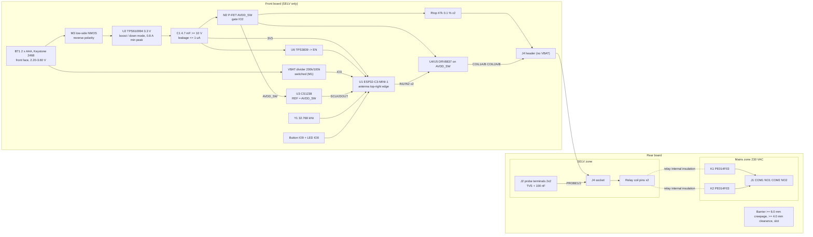

# Architecture: home-thermostat (round-4 rework: 2 x AAA)

Two-zone Wi-Fi/MQTT thermostat, two AAA cells in series, two latching relays switching 230 VAC, Italian 503 box.
Status: power stage reworked after PM round 4 (q1 2 x AAA, q2 low-leakage buffer, q3 cost <= 28 USD). Every number has a source in the "Sources" list (`[S1]`...) or a calculation here or in `notes/power_calc.py`. Python could not be run this session (needs approval), so the script and the hand arithmetic below must agree when it is run.

## 1. Chosen architecture (summary)

| Block | Choice | Deciding numbers |
|---|---|---|
| Radio + MCU + RTC | ESP32-C3-MINI-1 (PCB antenna), 32.768 kHz crystal on IO0/IO1 | Deep sleep 5 uA [S1]; drift about 20 ppm with per-wake calibration, under 46 ppm (R12) (section 7) |
| Power | 2 x AAA in series (2.20-3.60 V open circuit) -> low-side NMOS reverse protection -> TPS610994 (fixed 3.3 V boost, down mode above 3.25 V) -> 3V3 rail with a 4.7 mF, >= 10 V low-leakage buffer. TPS3839 supervisor on EN | Boost with a 0.7 V minimum VIN and a cycle-by-cycle limit keeps running at the 0 C cutoff; the TPS63900 buck-boost stops at its 1.63-1.67 V UVLO during TX (section 3.2) |
| Temperature | 10 k NTC probes + 47 k 0.1 % top resistors + CS1238 24-bit ratiometric ADC on AVDD_SW | +/-0.44 degC worst-case at 35 degC (section 5) |
| Relays | TE PE014F03 (1 coil, 3 V, 41 ohm, 5 A 250 VAC, 20 x 10 x 10 mm), 2 x DRV8837 on AVDD_SW, 40 ms pulses | Coil 3.23 V >= 2.7 V at the 0 C cutoff (section 6) |
| Mechanics | Two boards. The 2 x AAA holder sits on the front face of the front board (no cutout), the module at its top-right corner. The rear board carries relays, terminals and the mains zone only | Depth 28.2 mm against 30 mm; rear board 41 % full (section 8) |

## 2. Block diagram

The battery no longer crosses J4. J4 carries GND x2, COIL1A/B, COIL2A/B, PROBE1/2 and 2 spare pins (use them as GND guards between the coil and probe pins).

Pin plan: unchanged from the circuit stage (notes/circuit.md). IO2 drives the M2 gate (AVDD_SW), IO3 reads VBAT_SENSE, IO21 is spare.

## 3. Power tree

### 3.1 Rails

| Rail | Source | Load typ | Load peak | Regulator | Efficiency / drop |
|---|---|---|---|---|---|
| VBAT (pack) | 2 x AAA in series. Alkaline 3.2 V fresh (2 x 1.60), lithium L92 3.6 V fresh (2 x 1.80 [S6]); cutoff 2.20 V open circuit (2 x 1.10), 2.54 V at 0 C | sleep 11.8 uA (29.5 uW / 2.5 V); Wi-Fi wake 0.17 A fresh, 0.28 A at the 25 C cutoff, 0.34 A at the 0 C cutoff | the converter's average input limit, 0.65 / 0.85 / 1.10 A (min/typ/max), for the 5 ms TX burst | none | Rint per cell 0.15-0.30 ohm fresh (E92 [S5]), 0.14-0.18 (L92 [S6]); model 0.40 ohm at the cutoff (2 x the 0.2 ohm the L92 sheet shows for a fresh E92 under a 1 A pulse), 0.80 ohm at 0 C. Contacts + wiring + M3 0.07 ohm |
| 3V3 | U2 TPS610994YFF | 6.7 uA sleep; 150 mA Wi-Fi; 14.5 mA measuring | 350 mA TX [S1]; 89 mA relay coil | synchronous boost below VIN 3.25 V; down mode from VOUT - 50 mV to VOUT + 0.5 V = 3.8 V, where the PMOS regulates linearly; pass-through only above 3.8 V [S2 7.3.8] | 0.75 at 6.7 uA (datasheet text, Fig 6-5 reads 80-84 % at VIN 2.5 V); 0.92 at 10-300 mA with alkaline (Fig 6-5: 93-94 % at VIN 2.5 V); down mode 3.3 / VIN = 0.92-0.97 (lithium) |
| C1 on 3V3 | 4.7 mF, >= 10 V, D <= 12.5 mm lying flat, ESR <= 0.10 ohm at 20 C (<= 0.15 at 0 C), leakage <= 1 uA at 3.3 V / 25 C after 24 h | - | covers the TX deficit, at most 2.68 mJ (3.3) | - | ESR drop 0.35 A x 0.15 ohm = 53 mV at 0 C |
| AVDD_SW | M2 AO3401A from 3V3, gate IO2 (circuit stage) | CS1238 + two 47 k dividers for 50 ms; DRV8837 VM/VCC/nSLEEP | 92 mA coil for 40 ms | P-FET switch | < 10 mV drop at 92 mA (AO3401A < 0.1 ohm at -2.5 V) |
| VBAT_SENSE | pack via 200 k / 100 k 0.1 %, low side switched by M1 | 0 in sleep | 12 uA for 5 ms at 3.6 V | - | tap <= 1.2 V for ADC ATTEN2 (+/-10 mV [S1]). Circuit task: with M1 off the tap rises to VBAT (3.6 V), above VDD, so switch the high side instead or clamp the tap |

### 3.2 Converter choice (cost 3, battery life 2, size 1)

The pack spans 2.20-3.60 V, around the 3.3 V rail. The ESP32-C3 module allows 3.0-3.6 V and 3.6 V absolute maximum [S1], so pass-through of a 3.6 V lithium pack is not acceptable as a design point.

| Option | Cost (qty 10) | Battery life (alkaline, typ) | R3 at the cutoff | Size | Verdict |
|---|---|---|---|---|---|
| **A. Keep TPS610994 (boost + down mode)** | 1.21 + 0.06 inductor = 1.27 USD, no change | 16.0 months (sleep at 0.75) | Passes at 25 C and 0 C with the temperature-aware cutoff (3.3). VIN min 0.7 V and a cycle-by-cycle limit let it ride the pack sag | DSBGA 0.9 x 1.2 mm + 2520 inductor, about 15 mm2; hand assembly; 4.7 mF is 47 x the 100 uF COUT maximum (risk R-TPS-1, bench) | **chosen** |
| B. TPS63900 buck-boost (75 nA Iq, 1.8-5.5 V) [S7] | 1.13 USD (LCSC C1518762, about 9,800 in stock) + 36.5 k CFG resistor + 2 A inductor (about 0.1) = 1.24 USD | 16.4 months if R3 held (sleep at 88 %, Fig 8-9: +4.4 uW saved, +2.2 %) | Fails. UVLO falls at 1.63-1.67 V. Its input limit is 1-100 mA or unlimited, so the TX burst (1.36 W in) meets a pack whose maximum power is 1.39 W at the 25 C cutoff and 0.72 W at 0 C: VIN falls to 1.27 V at 25 C and the converter stops. At 0 C even the 1 s wake gives VIN 1.62 V. Holding R3 needs a cutoff of 1.20 V/cell at 25 C and 1.52 V/cell at 0 C, about 60 % usable alkaline at room temperature, so about 11 months (R2 fails) | WSON 2.5 x 2.5, 21 mm2; COUT has no upper limit | rejected |
| C. TPS63802 buck-boost [S8] | about 1 USD | 14.0 months typ, 12.1 months worst (11 uA Iq x 2.5 V = 27.5 uW at the pack, +14 %): R2 worst case fails | 5 A typ peak limit drives the pack past its maximum-power point at the cutoff: same collapse as B | 3 x 2 mm, 0.47 uH | rejected |
| D. TPS610994 with pass-through to the rail | - | - | 3.6 V pass-through equals the module absolute maximum | - | not used: the TPS610994 regulates in down mode up to 3.8 V |

Lithium pass-through margin: the L92 sheet shows 1.80 V open circuit [S6], so 3.60 V for the pack. That is 0.2 V below the 3.8 V pass-through entry (typical, no min/max given). Bench check: fresh L92 pair, no load, the rail must read 3.3-3.4 V (3.4 V typ in PFM [S2]).

### 3.3 Cutoff, R3 operating points and buffer size

The pack model is 2 cells, Voc at the cutoff, Rint per cell 0.40 ohm (25-50 C) / 0.80 ohm (0 C), + 0.07 ohm. The converter efficiency is interpolated from Fig 6-5: 0.80 at VIN 0.7 V, 0.83 at 1.0 V, 0.89 at 1.5 V, 0.93 at 2.5 V. The pack current comes from P = (Voc - I R) I.

| Case | Pack | Wi-Fi wake (0.495 W) | Relay + MCU (0.368 W) | TX burst at average input limit 0.65 / 0.85 / 1.10 A: VIN, deficit | C needed (effective, incl. ESR) |
|---|---|---|---|---|---|
| 25 C, cutoff 2 x 1.10 V | 2.20 V, 0.87 ohm, max power 1.39 W | 0.279 A, VIN 1.96 V | 0.200 A, VIN 2.03 V | 1.63 V, 1.02 mJ / 1.46 V, 0.28 mJ / 1.24 V, 0 | 1.17 mF |
| 0 C, cutoff 2 x 1.10 V (no cold rule) | 2.20 V, 1.67 ohm, max 0.72 W | 0.338 A, VIN 1.64 V | 0.224 A, VIN 1.83 V | 1.11 V, 2.72 mJ / 0.78 V, 3.10 mJ / **0.36 V: below UVLO, the boost stops** | 3.94 mF at typ; undefined at max |
| **0 C, cold cutoff 2 x 1.27 V** | 2.54 V, 1.67 ohm, max 0.97 W | 0.257 A, VIN 2.11 V | 0.180 A, VIN 2.24 V | 1.45 V, 1.59 mJ / 1.12 V, 1.75 mJ / 0.70 V, 2.68 mJ | **3.41 mF** |

Decisions:
- Low-battery cutoff (R16 trigger, R3 model): 1.10 V/cell open circuit at a box temperature of 8 C or more. Below that it rises so that VIN stays >= 0.7 V at the 1.10 A maximum limit: Voc >= 0.7 + 1.10 x (2 Rcell(T) + 0.07), with Rcell(T) = 0.40 x 2^((25 - T)/25). That gives 1.155 V/cell at 5 C and 1.27 V/cell at 0 C. Why 1.10 V: alkaline below 1.10 V open circuit holds about 10-15 % of its capacity (E92 low-drain curves: 1.1 V to 0.8 V is about 2.5 h of 22.5 h), and the pack still supplies Wi-Fi at 0.28-0.34 A, half the limit. The cold rule costs capacity only while the box is cold: about 60 % usable at 1.27 V, so about 11 months in a box held at 0 C.
- Buffer: **4.7 mF stays**. At room temperature 1.2 mF would do. The 0 C / maximum-limit corner needs 3.41 mF effective, and 4.7 mF x 0.8 (tolerance) x 0.95 (0 C) = 3.57 mF (5 % margin). 3.3 mF or 2 x 2.2 mF (3.34 mF effective) would fail that corner. Half the cell current does not shrink the buffer, because at 0 C the pack's maximum power (0.97 W) is still below the 1.155 W TX burst.
- Low-leakage requirement (PM round 4, q2): rated >= 10 V (the rail is 34 % of rating), leakage <= 1 uA at 3.3 V and 25 C after 24 h (<= 3 uA at 50 C). Bring-up measures 3 samples. Body diameter <= 12.5 mm so that it lies flat under the 13 mm holder height. At 3 uA the life is 15.4 months typ / 13.2 worst; at 5 uA it is 14.7 / 12.7 (worst fails), so the 1 uA limit matters.

### 3.4 Reverse polarity and supervisor

- M3 stays a low-side NMOS ideal diode (drain BAT-, source GND, gate to pack +). VGS is now the pack voltage, 2.2-3.6 V (down to about 1.0 V during a 0 C TX burst). Purchase spec: VDS >= 12 V, VGS max >= +/-8 V, RDS(on) <= 50 mOhm at VGS 1.8 V (specified), VGS(th) max <= 1.0 V, SOT-23. Drop at 0.65 A <= 33 mV. Many SOT-23 parts are specified at 1.8 V, so this is easier and cheaper than the 0.9-1.2 V spec of the 1 AA design.
- A high-side P-FET (gate to GND) would also work (VGS = -2.2 to -3.6 V). It was not chosen: at the same price, P-FETs have about 1.5-2 x the RDS(on).
- Keystone 2468 is not keyed. One reversed cell gives about 0 V and no current; two reversed cells are blocked by M3.
- U6 TPS3839K33 stays. The start-up problem is the same as with 1 AA. Below VOUT 1.6 V the boost limits the peak current to 200 mA, then ramps to 0.7 x ILIM [S2 7.3.4], so 4.7 mF takes tens of ms to reach 3.0 V. The 10 ms EN RC alone would release the ESP32 at 1.5-2 V. Sleep cost 150 nA (+0.6 uW at the pack).

## 4. Power budget (24 h profile) and runtime

Rail energy per state (unchanged profile):

| State | Calculation | Rail energy/day | Average at 3.3 V | Cell-side power |
|---|---|---|---|---|
| Wi-Fi wake, hourly (R11) | 24 x 0.5 J | 12.00 J | 42.09 uA | |
| Measurement wake, every 10 min | 144 x 5.3 mJ | 0.763 J | 2.68 uA | |
| Relay pulses | 40 x 10.6 mJ + MCU light sleep | 0.425 J | 1.49 uA | |
| LED (R18) | events | 0.029 J | 0.10 uA | |
| Active subtotal | | | 46.36 uA = 153.0 uW | / 0.92 = **166.3 uW** |
| Sleep floor | module 5.0 + XTAL 0.5 + C1 leakage 1.0 + U6 0.15 + IO3 leakage 0.05 (DRV8837 unpowered) | | 6.70 uA = 22.1 uW | / 0.75 = **29.5 uW** |
| **Total** | | | 53.06 uA at the rail | **195.8 uW = 78.3 uA at 2.5 V** |

Usable energy (the R2 arithmetic):
- Alkaline typical: E92 1.2 Ah at low drain to 0.8 V/cell [S5] (1150 mAh at 25 mA continuous). x 0.85 depth of discharge to the 1.10 V cutoff. x 0.90 for I2R loss in the 0.3 A wakes (about 6 %) and self-discharge (about 4 % over 16 months). x 2.5 V average pack voltage. = 8.26 kJ.
- Alkaline worst: 1.1 Ah x 0.80 x 0.90 x 2.5 V = 7.13 kJ.
- The 0.3 A pulses last 1 s per hour (0.03 % duty), so the 250 mA continuous capacity (670 mAh) does not apply. The E92 "Home Medical" test (250 mA, 5 min per hour) still gives 850 mAh to 1.0 V at 8 % duty.
- Lithium L92: 1.2 Ah x 0.97 (self-discharge) x 3.2 V average = 13.4 kJ. The L92 holds above 1.4 V until about 95 % of its capacity [S6], so the 1.10 V cutoff loses nothing.

Runtime:
- Alkaline: 8.26 kJ / 195.8 uW = 42.2 Ms = **16.0 months (1.34 years)** typical, **13.9 months** worst (7.13 kJ). R2 asks for >= 13 months. The "about 1.5 years" told to the PM in round 4 is corrected to about 16 months.
- Lithium (2 x L92): 13.4 kJ / 192.2 uW (0.94 active efficiency) = 69.8 Ms = **26.5 months (2.2 years)**. R2 asks for >= 2 years.
- R2 limit: 7.13 kJ / 34.2 Ms = 208 uW. The design is 195.8 uW, 6 % under.

Sensitivity (alkaline typ / worst):

| Case | Pack power | Life |
|---|---|---|
| C1 leakage 3 uA | 204.6 uW | 15.4 / 13.2 months |
| C1 leakage 5 uA | 213.4 uW | 14.7 / 12.7 months (worst fails) |
| Sleep floor 11.7 uA (module 8, C1 2, other 1) | 217.8 uW | 14.4 / 12.4 months (worst fails); measure at bring-up |
| Measure every 5 min | 205.4 uW | 15.3 / 13.2 months |
| Wi-Fi wake 1 J (full TLS each wake) | 346.7 uW | 9.1 months, fails: keep plain MQTT or TLS session resumption |
| Box held at 0 C (cold cutoff 1.27 V/cell) | 195.8 uW | about 11 months (60 % usable) |
| TPS63900 instead (if R3 held) | 191.4 uW | 16.4 months |

Pack-side currents for the cell model: sleep 11.8 uA, Wi-Fi 0.17-0.34 A for 1 s, TX burst up to 1.1 A for 5 ms, relay pulse 0.18-0.22 A for 40 ms. The single-AA design drew 0.47-0.65 A in a Wi-Fi wake.

## 5. Signal chain and error budget (R4, R5)

### 5.1 Architecture choice: sensor and converter

| Option | Converter error at 35 degC (14.66 mV/K) | Sensor | Total (worst-case) | Cost on board | Verdict |
|---|---|---|---|---|---|
| NTC + ESP32-C3 ADC, absolute | +/-10 mV (ATTEN2, calibrated [S1 T5-6]) = +/-0.68 degC | 0.34 degC | 1.02 degC | 0 | fails |
| NTC + ESP32-C3 ADC, ratiometric with a reference channel | INL +/-12 LSB [S1 T5-5] = about +/-5 mV = 0.35 degC + 0.12 degC through the reference | 0.34 degC | 0.81 degC worst, 0.47 degC RSS | +0.1 USD | fails or marginal |
| Digital probe sensor (TMP102 class) | 0 | 0.50 degC | 0.50 degC (0 % margin) | custom probes 3-5 USD each | rejected |
| DS18B20 | 2 x 750 ms x 22 mA x 3.3 V = 109 mJ per measurement | - | - | - | rejected by R2 |
| **NTC + external ratiometric 24-bit delta-sigma (CS1238)** | <= +/-0.2 mV after offset reading = 0.014 degC | 0.34 degC | **0.44 degC** | 0.91 USD | **chosen** |

### 5.2 Chain

AVDD_SW (about 3.3 V) -> Rtop 47 k 0.1 % 25 ppm/K -> node -> J4 -> J2 -> probe cable 2 m -> NTC 10 k -> GND. Node -> CS1238 AINx+ (AINx- = AGND), PGA = 1, full scale +/-0.5 VREF = +/-1.65 V [S4]; VREF = AVDD_SW (ratiometric). Node: 1 k + 100 nF to GND, TVS at J2.

Node voltage (B 3950): 5 degC 1.173 V; 25 degC 0.579 V; 35 degC 0.401 V; 50 degC 0.236 V. All inside +/-1.65 V. Sensitivity Vexc x Rtop x |dRn/dT| / (Rtop + Rn)^2: 38.6 mV/K at 5 degC, 21.2 at 25, 14.66 at 35 (worst).

| Block | Gain | Offset | Noise | Bandwidth | Error 35 degC | Error 5 degC |
|---|---|---|---|---|---|---|
| NTC R25 +/-1 % | alpha = 4.16 %/K | - | - | tau about 10 s | 0.240 | 0.196 |
| NTC B +/-1 % | - | - | - | - | 0.103 | 0.186 |
| Rtop 0.1 % (after the gain calibration, note c) | ratio 0.1216 | - | - | - | 0.0015 | 0.0055 |
| Rtop 25 ppm/K x 25 K | - | - | - | - | 0.015 | 0.012 |
| Cable 0.4 ohm (R5) | - | 0.006 % | - | 200 pF | 0.0015 | 0.0003 |
| TVS leakage 20 nA x 5.7 k | - | 0.114 mV | - | - | 0.008 | 0.009 |
| 50 Hz hum 0.94 mV, 20 ms timer window (>= 24 dB) | - | - | 0.094 mV | null at 50 Hz | 0.006 | 0.004 |
| RC node, Rth 5.7-16.7 k x 100 nF | 1 | - | - | 95-280 Hz, settles in 9-20 ms | 0 | 0 |
| CS1238 offset, PGA 1 (VREF cancels: ratiometric) | 1 | <= 0.2 mV residual after the CH_SEL 11 reading | about 10 uVrms after 25 samples | 1280 SPS | 0.014 | 0.005 |
| CS1238 gain error +/-0.5 % (typ, datasheet 1.6 table 3, PGA 128; no PGA 1 figure), UNCALIBRATED (note a) | 0.995-1.005 | - | - | - | (0.137) | (0.152) |
| Gain calibration residual: 10.00 k 0.1 % cal resistor + drift 8 ppm/C x 25 K (note b) | - | - | - | - | 0.028 | 0.031 |
| Self-heating (upper bound) | - | 24.8 / 53 uW | - | - | 0.017 | 0.035 |
| R-T table interpolation | - | - | - | - | 0.010 | 0.010 |
| **Worst-case sum, calibrated** | | | | | **0.44 degC** | **0.49 degC** |
| **RSS, calibrated** | | | | | **0.26 degC** | **0.27 degC** |
| Worst-case sum WITHOUT calibration (gain row in, Rtop row 0.024 / 0.020) | | | | | 0.58 degC | 0.63 degC |

Notes to the table (review of the Chipsea datasheet, notes/datasheets/cs1238.md; the earlier table counted the gain as "cancels", which was wrong: ratiometry cancels VREF, not the converter gain):
- a. Gain error: 35 C node 0.401 V x 0.5 % = 2.0 mV / 14.66 mV/K = 0.137 C; 5 C node 1.173 V x 0.5 % = 5.9 mV / 38.6 mV/K = 0.152 C. Without calibration the sums are 0.4385 + 0.137 = 0.58 C and 0.4773 + 0.152 = 0.63 C, over R4.
- b. One-point gain calibration per unit (lead decision): at bring-up a 10.00 k 0.1 % resistor replaces each probe at J2/J6, the firmware stores k = (10/57) / measured ratio per channel in flash and multiplies every reading by k. A cal resistor error d shifts the cal ratio by d x 47/57 = 0.0825 % at d = 0.1 %. Temperature error = 0.000825 x ratio / (d ratio / dT): 35 C 0.000825 x 0.1215 / 4.442e-3 /K = 0.0226 C; 5 C 0.000825 x 0.3555 / 0.011697 /K = 0.0251 C. Gain drift after a 25 C calibration: 8 ppm/C x 25 K = 0.02 %: 0.0055 C (35 C), 0.0061 C (5 C). Rows: 0.028 and 0.031 C.
- c. The calibration runs with the board's own Rtop in place, so it also removes most of the Rtop tolerance: residual r x (47/57 - Rtop/(Rtop + Rn)) = r x (0.8246 - 0.8785) at 35 C and r x (0.8246 - 0.6445) at 5 C, i.e. 0.0015 and 0.0055 C at r = 0.1 % (was 0.024 / 0.020). Rtop tempco is not calibrated out (row unchanged).
- Sums, calibrated: 35 C 0.240 + 0.103 + 0.0015 + 0.015 + 0.0015 + 0.008 + 0.006 + 0.014 + 0.028 + 0.017 + 0.010 = 0.444 C; 5 C 0.196 + 0.186 + 0.0055 + 0.012 + 0.0003 + 0.009 + 0.004 + 0.005 + 0.031 + 0.035 + 0.010 = 0.494 C (1.2 % margin to 0.5 C as a linear worst case; R4 is defined at MC 3 sigma). RSS: 0.264 C (35 C), 0.275 C (5 C).
- Simulated (ntc_tran, NTC R25 +1 %, B +/-1 %, gain +/-0.5 % with drift, Rcal +/-0.1 %, offset +0.2 mV, TVS leakage, cable): calibrated worst -0.407 C (ch1, 5 C), MC 50 -0.411 C; uncalibrated worst -0.536 C (ch1, 5 C), MC 50 -0.554 C.

Resolution 50 uV = 0.0034 degC (R4). The cable term is 0.0015 degC against 0.02 (R5).

### 5.3 Pack voltage (R16, R17)

VBAT -> 200 k / 100 k 0.1 % -> IO3 (ATTEN2, +/-10 mV [S1 T5-6]). 3.6 V gives 1.20 V at the tap. Error: 3 x 10 mV + 0.2 % x 3.6 V x 2/3 = 34.8 mV on the pack = 17.4 mV per cell, inside +/-60 mV (R17). The low-battery check reads the pack open circuit before the radio starts and compares it with the temperature-aware cutoff (3.3). The divider draws 12 uA for 5 ms per reading; in sleep the divider is off (see 3.1 for the circuit task on the tap voltage).

## 6. Relay drive and the low-battery safe state (R7, R9, R16)

- Relay: PE014F03, polarized 1-coil bistable. Set/reset 2.25 V, rated 3 V, 41 ohm +/-10 %, 20 ms min energization, 5 A 250 VAC, 100 k cycles [S3].
- Driver: 2 x DRV8837 on AVDD_SW (unpowered in sleep), 40 ms pulse + 1 ms brake.
- Coil voltage at the 0 C cutoff: the rail stays regulated, because the pack supplies 0.368 W (coil 0.295 W + MCU awake 0.073 W) at 0.224 A, VIN 1.83 V, a third of the 0.65 A limit. Coil = 3.3 - 0.089 A x 0.65 ohm (DRV8837) - < 10 mV (M2) = 3.23 V = 1.43 x 2.25 V. At 50 C the coil is +10 % and the must-operate about 2.3 V: ratio 1.40. R7 limit 1.2.
- R9 droop: an 89 mA step x C1 ESR 0.15 ohm (0 C) = 13 mV, under 100 mV. Relay pulses never overlap Wi-Fi (firmware rule). Rule 4 of notes/circuit.md (MCU in light sleep during pulses) is no longer needed for R7. Keep it, because it saves energy.
- R16: at the cutoff both reset pulses run from the pack with the rail regulated, then the MQTT alarm. The cell-removed reserve stays infeasible (C10). On cold boot both relays are driven to the commanded state.

## 7. Timekeeping (R12)

- The 32.768 kHz crystal has +/-20 ppm tolerance, -0.034 ppm/K^2 (typical) and +/-3 ppm aging. Raw drift: 44.3 ppm at 0 degC, 30.7 ppm at 40 degC.
- Each wake (every 10 min) recalibrates the slow clock against the 40 MHz crystal, which gives about 20 ppm. The hourly NTP sync also corrects it.
- No separate RTC. The crystal costs +0.5 uA of sleep current (in the budget).

## 8. Mechanics, isolation and RF keep-out (R1, R8, R9, R10)

### 8.1 Holder placement and depth stack

Holder: Keystone 2468 (KiCad `Battery:BatteryHolder_Keystone_2468_2xAAA`). Body 52.98 x 24.59 x 13 mm [S9], footprint bbox 54.0 x 25.6 mm. Both electrical pads are at the left end (pad 1 (0, 0), pad 2 (0, 12.7)); the right end has only an NPTH peg. AAA cell: 10.5 mm diameter, 44.5 mm long [S5].

| Layout | Area / fit | Depth | Verdict |
|---|---|---|---|
| Holder on the rear board, reached through a front-board cutout (the 1 AA plan) | The rear board needs holder 1382 + relays 400 + J1 160 + J2 98 + J4 65 + barrier 300 + MOVs 90 = 2495 mm2 of 2480 (101 %). The strip left beside the holder is 14.4 x 62 mm, and relays + J1 alone take 60 mm of it | 1.0 + 1.6 + 13 = 15.6 (holder column) | rejected: does not fit |
| Holder on the front board's rear face, between the boards | Holder and the rear-board tall parts share one plan area: 1382 + 400 + 160 + 98 + 65 + 300 = 2405 mm2 (97 %); the gap must grow to 14 mm; the battery is reached only by unplugging a board | 23.2 | rejected |
| **Holder on the front face of the front board** | Front face: holder at the bottom (it may overhang the bottom PCB edge by up to 1.2 mm, inside the 44 mm envelope), module 13.2 x 16.6 at the top-right corner (x 48.8-62, y 23.4-40) with its antenna at the top edge, C1 lying flat (D12.5 x 25) at the top-left, button and LED. Other front-board parts go on its rear face (two-sided, hand assembly). Rear board: 1023 mm2 (41 %) | 1.0 + 1.6 + 10.0 (relay) + 1.0 + 1.6 + 13.0 (holder) = **28.2 mm** (1.8 mm margin) | **chosen** |

- Battery access: remove the screw-fixed cover and plate; the cells sit on the front face with no cutout. The cells are 2 boards away from the mains zone, which helps R8.
- The holder body is 24.6 mm tall and the module needs 16.6 mm, so 41.2 mm against the 40 mm PCB height. The holder therefore overhangs the bottom edge by up to 1.2 mm (the plastic body only; pads and pegs stay on the board), and the courtyard rule must allow it. If the enclosure cannot take this, use AAA clips with a block <= 23.4 mm wide (parts-stage alternative).

### 8.2 RF keep-out and the mains zone

- Antenna (y >= 34.6 mm, x >= 48.8 mm) to the holder top (y <= 23.4 mm): 11.2 mm; to the cell cans: about 11.5 mm. The guideline is 10 mm.
- Rear-board mains zone: x >= 8 mm (>= 4 mm in plan from the holder pads at x <= 3), y <= 15 across the width plus x 8-40 up to y 22. That is about 1030 mm2 for relays 400 + J1 160 + MOVs 90 + slot.
- Distance from the mains zone to the antenna: the nearest corner (40, 22) is 15.4 mm away, more than the 15 mm required (R9).
- No rear-board copper under the antenna projection (about 13 x 10 mm at the top-right corner).
- Front-board copper keep-out: as before, no copper within 4 mm in plan of the J1 terminals, the relay pins and the MOVs. The J1 screw heads are 1 mm under the front board.

### 8.3 Isolation plan (R8)

Unchanged:
- PCB mains-to-SELV creepage >= 6.0 mm and clearance >= 4.0 mm, with a routed slot.
- The relay is basic insulation (4 mm internal creepage), accepted for prototypes with a screw-fixed cover and a breaker-off instruction (PM round 3, q1).
- The battery now sits on the SELV front board, 11 mm of air plus 1.6 mm of FR-4 above the rear board.

## 9. Interface list

| Ref | Connector | Pins | Voltage levels | Protection |
|---|---|---|---|---|
| J1 (rear, mains) | 2 x KF301-5.0-2P, 250 V / 17 A, 10 mm tall | COM1, NO1, COM2, NO2 | 230 VAC, up to 2 A | Reinforced barrier from SELV; DNP MOV footprints RV1/RV2 |
| J2 (rear, SELV) | 2 x KF250-3.5-2P | PROBE1, GND, PROBE2, GND | 0-1.2 V for 50 ms, 0 V in sleep | ESD5Z5CL per line, 100 nF; probe cable 300/500 V or double insulated |
| J4 (both boards) | 2 x 5, 2.54 mm, 11 mm stack | GND x2, COIL1A, COIL1B, COIL2A, COIL2B, PROBE1, PROBE2, 2 spare (GND guards) | coils 3.3 V, 89 mA; probes 0-1.2 V | SELV only. VBAT no longer crosses J4 |
| BT1 (front face) | Keystone 2468, 2 x AAA, PC pins | BAT+, BAT- | 2.20-3.60 V open circuit; up to 1.1 A for 5 ms | M3 low-side NMOS (reverse); the holder is not keyed |
| SW1, D1 (front) | tact switch on IO9; LED on IO8 | - | 3.3 V logic | ESD5Z5CL on SW1 (R14) |
| J5 programming pads | 6 pads, pogo jig | 3V3, GND, D-, D+, EN, IO9 | 3.3 V USB-Serial/JTAG | internal only |

## 10. Cost (qty 10, R19 <= 28 USD)

| Change from the review-1 BOM (27.16 USD) | Delta |
|---|---|
| Keystone 2460 (0.93) -> Keystone 2468 2 x AAA (1.18 USD, DigiKey qty 1 [S9]) | +0.25 |
| C1 ECA-0JHG472B (0.52) -> 4.7 mF >= 10 V low leakage (PM round 4, q2) | +0.40 |
| U2 TPS610994 kept; M3 respecified at VGS 1.8 V (common, about 0.05-0.10 USD) | 0 |
| VBAT divider top 100 k -> 200 k | 0 |
| **Estimate** | **27.81 USD** (0.19 USD under 28; the parts stage confirms) |

## Sources

- [S1] Espressif ESP32-C3-MINI-1 datasheet v2.2 and ESP32-C3 Series Datasheet v2.4: VDD 3.0-3.6 V, absolute maximum 3.6 V; TX 350 mA; deep sleep 5 uA; ADC ATTEN0-2 +/-10 mV, ATTEN3 +/-35 mV.
- [S2] TI TPS61099 SLVSD88M (Aug 2026), https://www.ti.com/lit/gpn/TPS61099. Read this session, p.7-13. Fig 6-5 TPS610994 efficiency at VIN 0.7/1.5/2.5/3.0 V. 7.3.4 start-up: 200 mA peak below VOUT 1.6 V, then 0.7 x ILIM. 7.3.5 current limit in down mode. 7.3.8 down mode from VIN > VOUT - 50 mV, pass-through above VOUT + 0.5 V, back to down mode at 103 % of VOUT. Current limit 0.8/1.0/1.25 A, VIN 0.7-5.5 V, COUT max 100 uF (p.4-5, notes/datasheets/tps610994.md).
- [S3] TE Schrack PE bistable datasheet (PE014F03).
- [S4] Chipsea CS1238 (LCSC C81829); pin map and REFIN still to verify against the Chipsea PDF (review M4).
- [S5] Energizer E92 datasheet (Form EBC-1103-M), https://data.energizer.com/pdfs/e92.pdf. IR 150-300 mOhm fresh. Capacity to 0.8 V at 21 C: about 1150 / 940 / 670 / 430 mAh at 25 / 100 / 250 / 500 mA. Home Medical 250 mA 5 min/h: 1.0 V at about 205 min. 10.5 x 44.5 mm.
- [S6] Energizer L92 datasheet (Form L92GL1222), https://data.energizer.com/pdfs/l92.pdf. OCV 1.8 V. IR 140-180 mOhm, about 0.2 ohm flat to 1200 mAh. About 1200-1250 mAh at low drain. Capacity at 0 C, 250 mA: about 1150 mAh. E92 under a 1 A pulse about 0.2 ohm (comparison curve).
- [S7] TI TPS63900 SLVSET3D, https://www.ti.com/lit/gpn/TPS63900. Read p.1-8, 13-24. VIN 1.8-5.5 V, Iq 75 nA. UVLO rising 1.73-1.77 V, hysteresis 90-110 mV. Peak limit 1.33-1.6 A. Input current limit 1-100 mA or unlimited. IO 0.4 A at VI >= 2.0 V. Fig 8-7/8-9: about 88 % at 5 uA, 89-93 % at 100 mA. No COUT upper limit. LCSC C1518762 about 1.13-1.21 USD.
- [S8] TI TPS63802 product page: Iq 11 uA, 5 A typ peak limit, 1.3-5.5 V (1.8 V start-up).
- [S9] Keystone 2468: 52.98 x 24.59 x 13 mm; DigiKey 36-2468-ND, 1.18 USD qty 1 (search result, page not opened).
