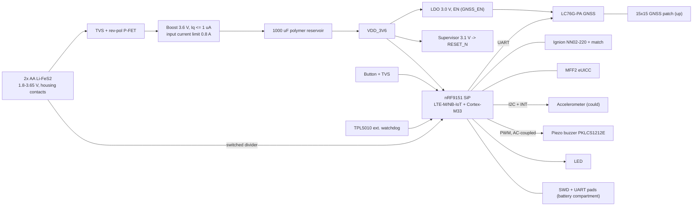

# Architecture (stage 2): dog-collar GPS tracker

Datasheet facts: `notes/datasheets/nrf9151.md`, `lc76g.md`, `nn02-220.md`, `bg77.md`. Battery-side factor: active k = 3.6 V / (3.0 V x 0.85) = 1.41; sleep k_s = 3.6 / (3.0 x 0.75) = 1.60 (boost efficiency at uA load assumed 75 %, stage 3 confirms).

## 1. Modem / SiP choice

| option | supply | sleep (datasheet) | GNSS | parts | price @1k | verdict |
|---|---|---|---|---|---|---|
| **A nRF9151 SiP + Quectel LC76G-PA (chosen)** | 3.0-5.5 V (design floor 3.2 V, Thingy:91 X) | PSM 2.7 uA, eDRX 81.92 s 18 uA Cat-M1 / 32 uA NB (UICC incl.) | LC76G: GPS+GLONASS+Galileo+BDS+QZSS, 8.2-10 mA tracking, runs in parallel with LTE | 2 | 13.75 + ~5 | lowest sleep, one MCU, IF-3 met |
| B nRF9151 alone | as A | as A | **GPS L1 + QZSS only, no Galileo** (PS v1.0) | 1 | 13.75 | fails IF-3 (Galileo); saves ~5 USD, 0.5 g, ~100 mm2: PM question C6 |
| C Quectel BG77 + MCU | 2.6-4.8 V (start > 2.7 V) | PSM 3.2 uA; eDRX 81.92 s average not confirmed (one distributor lists 0.67 mA) | GNSS incl. Galileo, time-shared with LTE | 2 | ~12 + MCU 1.5 | rejected: eDRX current unverified / higher, two firmware targets, boost still needed (cells 1.8 V < 2.6 V) |
| D u-blox SARA-R52 (M10 variant) | 3.0-4.5 V (not verified) | not verified | M10 incl. Galileo | 1-2 | > 20 (not verified) | rejected on cost, not surveyed further (search cap) |

C1 figures checked: eDRX 18 uA (C1 assumed 18 uA paging + 5 uA floor, i.e. the floor was counted twice: conservative); modem minimum 3.0 V confirmed (3.2 V practical); C1's 40 mA nRF91 GNSS is replaced by LC76G 10 mA. Availability: LCSC C22397843 out of stock (2026-10); Future Electronics 2300 pcs, Symmetry 13.75 USD @1000. KiCad: no nRF9151 or LC76G footprint (LC76G uses `RF_GPS:Quectel_L76`, footprint-compatible); nRF9151 LGA-113 needs a project footprint at stage 3.

## 2. Block diagram



## 3. Power tree

| rail | source | load typ / peak | regulator | efficiency / dropout |
|---|---|---|---|---|
| BAT_P 1.8-3.65 V | 2x AA Li-FeS2, rev-pol P-FET | 6-10 uA sleep / 0.8 A (input limit) | - | FET drop at 0.8 A <= 60 mV (budget below) |
| VDD_3V6 | boost from BAT_P | 18 uA eDRX avg / 0.5 A TX (2 ms) | synchronous boost, Iq <= 1 uA, input limit ~0.8 A, UVLO <= 1.8 V | 85 % active, ~75 % at uA load |
| VDD_GNSS 3.0 V | LDO from VDD_3V6, EN by GPIO | 0 off (3 nA) / 10 mA tracking | LDO, Iq < 1 uA (TPS7A02 class) | 3.0/3.6 = 83 %, dropout 0.6 V available |

Boost 3.6 V rather than 3.3 V: 0.4 V above the 3.2 V practical floor of nRF9151 (3.3 V leaves 0.1 V); the LDO keeps LC76G under its 3.6 V maximum. LDO against direct 3.3 V for GNSS: the LDO also gates GNSS fully off (LC76G backup 13 uA would exceed PWR-5 alone).

## 4. Power budget and life (battery side, 2350 mAh usable, C1)

Per-event charges (modem side, 3.6 V rail): A-GNSS assistance download 0.3 C; fix 10 mA x 30 s = 0.3 C; upload + RRC tail with RAI 0.25 C; lost-mode hot fix 10 mA x 5 s = 0.05 C; TAU 40 mC; poll 0.2 C.

| line | modem side uA | k | battery uA |
|---|---|---|---|
| nRF9151 eDRX 81.92 s Cat-M1 (incl. PSM floor and UICC) | 18 | 1.60 | 28.8 |
| floor rest: app RTC 1 + accel 1 + supervisor/WDT 0.4 + leakage 0.5 | 2.9 | 1.60 | 4.6 |
| boost Iq | - | - | 1.0 |
| TAU 12 h: 40 mC / 43200 s | 0.93 | 1.41 | 1.3 |
| 2 requests/day: 2 x 0.85 C / 86400 s | 19.7 | 1.41 | 27.8 |
| lost mode 1 x 2 h/month: 120 x 0.3 C / 2.59e6 s | 13.9 | 1.41 | 19.6 |
| LED + buzzer (C1) | 1.0 | 1.41 | 1.4 |
| **total eDRX (chosen)** | | | **84.5** |

| mode | battery uA | life | PWR-2 1630 / PWR-3 268 |
|---|---|---|---|
| eDRX 81.92 s Cat-M1, TAU 12 h | 84.5 | 27800 h = 38 mo | met / met |
| eDRX, operator TAU 54 min (+12.3 x 1.41) | 100.5 | 23400 h = 32 mo | met / met |
| eDRX on NB-IoT (32 uA) | 106.9 | 22000 h = 30 mo | met / met |
| eDRX refused -> 60-min poll (2.7 x 1.6 + 4.6 + 1 + 55.6 x 1.41 + 27.8 + 19.6 + 1.4) | 137.1 | 17100 h = 24 mo | met / met |
| eDRX refused, no fallback (DRX ~600 uA) | ~900 | 2600 h = 3.6 mo | met / missed |

Per mode currents: sleep 9-10 uA; eDRX 34 uA; poll event 0.2 C; fix 10 mA x 1.41 = 14 mA battery; upload ~100 mA; lost mode 5 mA modem = 7.05 mA battery for 2 h = 14.1 mAh per session; buzzer 30 mA x 10 s. Lost-mode sessions that fit PWR-3: (268 - 64.9) / 19.6 = 10 per month (interface.yaml says 6 from the stage-1b numbers; firmware may keep 6). FOTA (C4): a 300 kB image at ~100 kbit/s = 24 s x 50 mA = 1.2 C per update, 0.04 uA at one a year.

PWR-5 sleep floor at 3.0 V: (2.7 + 2.9 + 1.0 supercap leakage) x 1.60 + 1.0 = **11.6 uA against 15 uA** (PWR-5 re-allocated, notes/sleep-floor-reallocation.md).

## 5. C2: TX peak from cold cells (PWR-4)

Cold cells 3.0 V, 1.5 ohm, boost input floor 1.8 V: I_in max = (3.0 - 1.8) / 1.5 = 0.80 A, P_in 1.44 W, P_out 1.22 W = 0.34 A at 3.6 V. TX burst 0.5 A x 3.6 V = 1.8 W: deficit 0.16 A.

| option | arithmetic | cost | verdict |
|---|---|---|---|
| (1) battery-side bulk | 1 A x 2 ms / 0.5 V = 4000 uF at 4 V | ~2 USD, ~2 g, 2-4 caps | rejected (mass, cost) |
| (2) input-limited boost + 1000 uF output reservoir (chosen for Li-FeS2 only; superseded by section 16 for PWR-7) | 0.16 A x 2 ms / 0.32 V = 1000 uF (3.6 -> 3.28 V, 0.08 V left for copper/ESR) | 1000 uF 6.3 V polymer ~0.5 USD, 0.4 g, 7.3 x 4.3 x 2.8 mm | meets PWR-4 2 ms burst |
| (3) power class 5 (20 dBm) when cold | ~0.33 A x 3.6 = 1.2 W <= 1.22 W: sustainable for any burst length | link margin -3 dB | firmware rule for long CE-mode bursts: VBAT under load < 2.4 V -> PC5 |
| supercap for a 100 ms CE burst | 0.16 A x 0.1 s / 0.3 V = 53 mF, 2 EDLC in series | ~3 USD, 3 g, uA leakage | rejected (PWR-5, mass) |

## 6. C3: antennas

- LTE: Ignion ALL mXTEND NN02-220 (24 x 12 x 2 mm, 698-960 / 1710-2690 MHz) on the right short edge, clearance 13 x 35 mm copper-free on all layers, ground length 57 mm. Ignion AN Table 4: low band average efficiency 19.7 % at 60 mm, 28.3 % at 80 mm, 44.7 % at 100 mm (60 mm wide board; ours is 35 mm wide, so the figure is optimistic). Our 57 mm gives ~19 % (-7.2 dB), 3.7 dB below a 100 mm board. Lengthening to 90 mm (77 mm ground, ~27 %) gains ~1.5 dB for +20 mm: PM decision (C3). A flex antenna along the strap is rejected: cable through the IP67 seal, chewing (ENV-4). Energy: the life table has 3.2x headroom on PWR-3 (84.5 vs 268 uA); doubling all TX energy (requests, polls, lost mode) still gives about 130 uA eDRX / 220 uA poll.
- GNSS: 15 x 15 x 4 mm ceramic patch on the front face (outward/up when worn), on the ground plane at the far end from the LTE antenna (45 mm apart), LC76G-PA beside it. A chip antenna (~-5 dB more) would lengthen fixes and the 30 s fix cap of IF-2.

## 7. C5: latency

With a separate GNSS receiver the fix starts at the page, in parallel with the RRC connection, so worst case = 81.92 (eDRX) + max(30 fix, connect) + 10 upload = 121.92 s, 0.08 s under 122 s. The 30 s and 10 s are firmware caps (timeouts), so the worst case is bounded by them; but paging inside the PTW (1.28-2.56 s) and the A-GNSS download are not in the sum. Open question (not changed): should IF-2's acceptance read the product number "about 2 min" as a worst case of e.g. 125 s (adds PTW 2.56 s) or stay 122 s with the timeouts shortened to 27 s + 10 s? Mean latency is 41 + 30 + 10 = 81 s.

## 8. Battery voltage measurement (PWR-6, 50 mV)

Divider 2 x 200 kohm 0.1 %, switched by VBAT_SENSE_EN (P-FET, default off), 10 nF at AIN, nRF9151 SAADC 12-bit, internal reference, gain 1/6 (3.6 V FS at the pin, 1.8 V max after the divider).

| block | error at 3.0 V | note |
|---|---|---|
| divider ratio, 2 x 0.1 % | 6 mV | worst case 0.2 % |
| SAADC gain after one-point factory calibration, temperature drift | 15 mV | uncalibrated gain error of a few % (~90 mV) fails: calibration is required (stage 3 confirms SAADC figures) |
| INL +-2 LSB (0.88 mV x 2 divider) | 3.5 mV | |
| noise, 16-sample average | 1 mV | |
| AIN leakage x 100 kohm source | 5 mV | assumed 50 nA, stage 3 confirms |
| **sum of squares** | **17 mV** | <= 50 mV |

Divider current while on: 3.6 V / 400 kohm = 9 uA for 1 ms per hour: 0.003 uA.

## 9. Interfaces

| interface | pins | levels | protection |
|---|---|---|---|
| battery wire pads (back face) | BAT_P, GND (THT, hand-soldered wires from the housing contacts) | 1.8-3.65 V | rev-pol P-FET, TVS >= 8 kV contact (ENV-3); cells' internal PTC (Li-FeS2 AA); no fuse needed (not mains) |
| button (membrane) | BTN | VDD_GPIO, pull-up | TVS on BTN (ENV-3) |
| SWD + UART pads (back, compartment window) | VDD_3V6, SWDIO, SWCLK, RESET_N, GND, UART_TX, UART_RX | VDD_GPIO | series 100 ohm on UART, reached only with cells out |
| LTE antenna | RF 50 ohm CPWG L1 over L2 GND | - | pi match (Ignion Table 5 values for 60 mm) |
| GNSS antenna | RF 50 ohm | - | match; SAW per LC76G HW design (stage 3) |
| eSIM MFF2 | SIM_VCC, CLK, RST, IO | 1.8 V | ESD array not needed (soldered, not exposed) |

No external connector (ENV-2): no `envelope_mm` items; `wall_mm` 4 mm all round (MECH-2).

GPIO allocation (pins named at stage 4 from the nRF9151 symbol): BTN (GPIO with SENSE wake), LED (GPIO), BUZ_DRV (PWM), VBAT_SENSE (AIN0), VBAT_SENSE_EN (GPIO), BOOST_PG (GPIO, dropped if the boost has none), RESET_N (nRESET, supervisor), ACCEL_SDA/SCL (TWIM), ACCEL_INT (GPIO SENSE), SWDIO/SWCLK (dedicated), UART_TX/RX (UARTE0 log), new: GNSS_TX/GNSS_RX (UARTE1), GNSS_EN (LDO EN), WDT_DONE / WDT_WAKE (TPL5010). 17 of 32 GPIOs.

## 10. Mass budget (MECH-1, 60 g)

| item | g |
|---|---|
| 2x AA Li-FeS2 | 29.0 |
| PCB 70 x 35 x 1.0 mm FR-4 (2.45 cm3 x 1.85) | 4.5 |
| GNSS patch 15x15x4 | 3.6 |
| LTE chip antenna | 1.2 |
| SiP 0.4 + LC76G 0.5 + buzzer 0.5 + reservoir 0.4 + other parts 1.0 | 2.8 |
| cell contacts + wires 2.0, 4 screws 0.6 | 2.6 |
| **electronics + cells** | **43.7** |
| enclosure: 76 x 41 x 26 mm shell 1.2 mm PC (14.8 cm3 x 1.2) 17.7 + compartment ceiling 2.9 + gasket/latch 0.5 | 21.1 |
| **total (stage-2 first pass)** | **64.8**; after section 16: **64.2 <= 65 g** (MECH-1, PM round 3, q2) |

## 11. Board construction and floorplan

- 4 layers, 1.0 mm: nRF9151 LGA escape and 50 ohm lines over a solid GND (Nordic reference designs are 4-layer); 2 layers would need ~1 mm wide CPWG and lose the ground under the SiP.
- Construction: one board, all SMD parts on the front (MECH-3); the back holds only the 7 test pads and the 2 battery wire pads. Cells lie in the housing below a compartment ceiling (not on the board): Keystone 2462 2xAA PCB holder is 60.0 x 33.4 mm, on a 35 mm board it would leave 0.78 mm per side against the 1 mm edge rule (MECH-2), rejected (with the cells off the board the MECH-2 edge rule applies only to the board parts; the row is the reason the holder was not used, not an open item); cells beside the board in plane make the housing 64 mm wide (35 + 29), rejected for the collar. Stacked boards: no isolation need, rejected (cost).
- Depth stack: front wall 2 + patch 4 + board 1 + back pads 1.5 + compartment (ceiling 1 + gap 0.5 + AA 14.5 + door 1.5) 17.5 = 26 mm (lead estimate, no requirement number).
- Fixing: 4 x M2 self-tapping screws into bosses of the compartment ceiling, head 4.5 mm (`mechanical: screw`, conductive, not accessible: inside the sealed shell). IP67 gasket is in the housing door and shell joint, not on the board.
- Floorplan verdicts (after section 16): `--stage arch` PASS; full PASS (front 67 %, back 26 %, depth 26.7 / 27 mm lead estimate).

Mechanical/safety checklist: overcurrent on mains n/a (no mains or hazardous energy; cells limit by their PTC, `hwflow check` no `mains-fuse`); fixing: 4 screws as above; cover / IPXXB n/a (SELV 3.6 V only); creepage/clearance n/a (no hazardous nets); insulation thickness n/a (no standard clause applies to < 4 V SELV, product is RED + EN 62368-1 class ES1); cable insulation n/a.

## 12. Layout budgets (for stage 4: `hwflow check` rejects paths before components exist)

```yaml
budgets:
  - {name: battery_input_copper, req: PWR-4, kind: copper_r, path: ["<BAT pad> -> <Q_REV>", "<Q_REV> -> <L_BOOST>"], current_a: 0.25, max_mohm: 80,   # section 16: input limit 0.25 A; 80 mOhm x 0.25 A = 20 mV, same drop as before
     source: "boost input floor 1.8 V = 3.0 - 0.8 x 1.5: copper comes from the output droop allowance 3.6 - 3.2 = 0.4 V; reservoir 0.32 V, left 0.08 V: copper 25 mOhm x 0.8 A = 20 mV, FET 60 mV (circuit stage replaces 0.32 V with the simulated droop)"}
  - {name: reservoir_to_sip_vdd, req: PWR-4, kind: copper_r, path: ["<C_RES.1> -> <U1 VDD pins>"], current_a: 0.5, max_mohm: 40,
     source: "40 mV of the 80 mV left / 0.5 A = 80 mOhm, half for this leg"}
  - {name: sip_decoupling, kind: copper_len, path: ["<C_VDD.1> -> <U1 VDD>"], max_mm: 4, source: "board.decap_max_mm default; Nordic reference"}
```

## 13. Lead decisions (logged in conflicts.md)

External watchdog TPL5010 (35 nA, ~0.35 USD): yes. Buzzer: AC-coupled piezo drive (a stuck DC level is silent) plus watchdog reset: hardware cap = watchdog period 60 s. SIM: MFF2 eUICC soldered (no holder, no door, shock/water proof; 30 mm2 against ~200 mm2 for a nano-SIM holder).

## 14. Cost estimate (COST-1 30 USD @1000)

nRF9151 13.75, LC76G ~5, LTE antenna ~2, GNSS patch ~2, boost 1.0, LDO 0.2, reservoir 0.5, buzzer 0.6, accel 0.8, TVS x3 0.3, supervisor 0.3, TPL5010 0.35, button 0.1, LED 0.05, passives 1.5, PCB 4L 1.0 = 29.5 USD first pass; after section 16 **32.1 USD <= 50 USD** (COST-1, PM round 4, q1; nRF9151 out of stock at LCSC: global sourcing).

## 15. Risks

Front fill 72 %; PWR-5 at 10.0 / 10 uA; LTE efficiency ~19 % on a 35 mm wide board (simulate with Ignion); mass 64.8 g; nRF9151 3.2 V practical floor to confirm; LCSC stock.

## 16. Rework after PM rounds 3 and 4

Applied: LC76G kept (round 3 q1), MECH-1 65 g (q2), IF-2 125 s (q3: 81.92 + 2.56 PTW + 30 + 10 = 124.5 s), soldered MFF2 eSIM (q4), alkaline AA must work (q5, new PWR-7), no backup cell (q6), COST-1 50 USD (round 4 q1).

**Power-loss behaviour (round 3, q6):** on cell removal or brown-out the supervisor (3.1 V on VDD_3V6) holds RESET_N; the supercap discharges through the load (no backup). At the next power-up: boost start (supercap charge 0.16 F x 3.6 V / 0.3 A = 1.9 s), reset release, network attach with eDRX request, no stored position or time; the server marks the gap. No requirement number on boot time.

**Alkaline (PWR-7).** Energizer E91: 250 mA at -20 C gives CCV ~0.95 V against ~1.45 V OCV: 2.0 ohm per cell, pair 2.8 V / 4.0 ohm (notes/datasheets/e91.md; rated only to -18 C). Boost input held at >= 1.8 V: I_in = (2.8 - 1.8) / 4.0 = 0.25 A, P_in 0.45 W, P_out 0.38 W = 0.106 A at 3.6 V; TX 0.5 A: deficit 0.39 A.

| option | arithmetic | mass / cost | verdict |
|---|---|---|---|
| larger polymer bank | 100 ms: 0.39 x 0.1 / 0.32 V = 122 mF (122 x 1000 uF) | ~50 g | impossible |
| 2 ms only (PWR-4 burst) | 0.39 x 2 ms / 0.32 V = 2.5 mF (3 x 1000 uF) | +0.8 g, +1 USD | too short for CE repetitions, rejected |
| lower boost input limit (0.25 A) alone | 0.106 A at 3.6 V < any TX current | 0 | brown-out on every TX, rejected alone |
| firmware back-off alone (PC5 20 dBm ~0.33 A) | 0.33 A > 0.106 A available | 0 | rejected alone |
| **boost input limit 0.25 A (or input-voltage regulation >= 1.85 V) + 160 mF 5 V dual-cell supercap on VDD_3V6 (CAP-XX GW209F class, 55 mOhm) + firmware back-off (chosen)** | hold-up 0.16 F x (0.40 - 0.39 A x 0.055 ohm = 0.36 V) / 0.39 A = **148 ms** at full power; charge per connection 0.16 x 0.36 = 58 mC; recharge at 0.106 A surplus; firmware: VBAT under load < 2.4 V or T < 0 C -> PC5, RAI, wait for VDD_3V6 >= 3.5 V before the next TX | +2.0 g (class estimate) - 0.4 g polymer; +3.0 - 0.5 USD | meets PWR-7 100 ms with 48 ms margin and PWR-4 (Li-FeS2: deficit 0.5 - 0.15 = 0.35 A at a 0.25 A limit, 165 ms) |

Supercap on the back face (28.5 x 17 x 2.4 mm class): the front would fill 89 %. That is a MECH-3 (should) deviation: hand-soldered or second-side reflow (product person: accept, or a longer board). Leakage ~1 uA at 3.6 V (class value, stage 3 confirms) enters PWR-5 (11.6 uA).

**Mass (MECH-1 65 g):** 64.8 - PCB 1.0 -> 0.8 mm 0.9 - GNSS patch 15 -> 12 mm 1.3 - polymer 0.4 + supercap 2.0 = **64.2 g** (0.8 g margin). On alkaline cells: 64.2 - 29.0 + 46.0 = **81.2 g** (C10; MECH-1 is written for Li-FeS2). The 12 x 12 patch costs ~1 dB GNSS gain (lead estimate): longer fixes, inside the 30 s cap in open sky.

**Cost (COST-1 50 USD):** 29.5 - 0.5 polymer + 3.0 supercap + 0.1 MLCC = **32.1 USD**.

**Life (2350 mAh Li-FeS2; alkaline 2850 mAh x 0.6 = 1710 mAh usable, an estimate for cold and the 1.8 V pulse cut-off):**

| mode | battery uA | Li-FeS2 | alkaline |
|---|---|---|---|
| eDRX 81.92 s, TAU 12 h | 86.1 | 27300 h = 37 mo | 19900 h = 27 mo |
| 60-min poll fallback | 138.7 | 16900 h = 23 mo | 12300 h = 17 mo |
