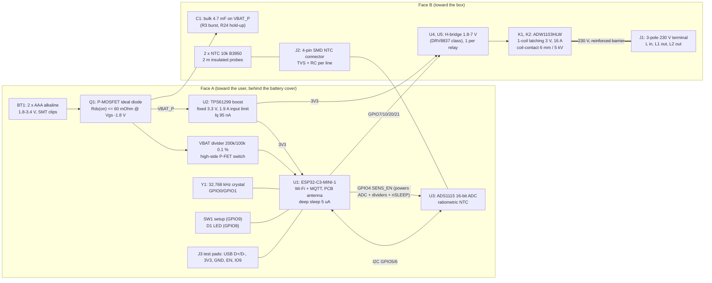

# home-thermostat-3: architecture (stage 2)

Inputs: `requirements.yaml` (R1-R34), `conflicts.md` (C1-C5 resolved in round 1). Datasheet facts are in `notes/datasheets/` (ESP32-C3, TPS61299/TPS61099, ADW1103HLW/PE014F03, ADS1115). Values marked **(assumed)** have no datasheet yet and stage 3 must confirm them. New conflicts C6-C9 are in `conflicts.md`.

Battery-side figures use the R5 conditions: VBAT = 2.6 V (mid-life), boost efficiency 88 % at mA loads and 80 % at uA loads (sensitivity at 75 % is given), usable capacity 825 mAh.

## 1. Block diagram



R21: the schedule and set-points live in the ESP32-C3 flash (NVS); NTC reading, control loop and relay drive run on U1 with no network dependency. Wi-Fi only carries remote commands and status, once per 60 min.

## 2. Architecture choices (numbers that decide)

### 2.1 Boost converter: TPS61299 (1.9 A input limit) instead of TPS61099

| | TPS61099 | TPS61299 (1.9 A variant) |
|---|---|---|
| VIN range / start-up | 0.7-5.5 V / 0.7 V | 0.5-5.5 V / 0.7 V |
| Iq | 0.6 uA (VOUT) + 0.4 uA (VIN) | 0.095 uA (VOUT) |
| Current limit | 0.8 A switch peak | 1.9 A input |
| IOUT at 3.3 V from VIN = 1.8 V | 1.8 x 0.7 A x 0.85 / 3.3 = 0.32 A < 0.35 A: **fails R3** | 1.8 x 1.9 x 0.85 / 3.3 = 0.88 A |
| VIN needed for 350 mA | 3.3 x 0.35 / (0.7 x 0.85) = 1.94 V | 3.3 x 0.35 / (1.9 x 0.85) = 0.72 V |
| Package | WCSP / WSON 2 x 2 | WCSP / SOT563 1.6 x 1.6 |

Sleep-floor effect of Iq at the battery: TPS61099 1.0 uA x 3.3/2.6/0.8 = 1.6 uA; TPS61299 0.095 x 3.3/2.6/0.8 = 0.15 uA. TPS61299 wins on both. Stage 3 confirms the fixed 3.3 V / 1.9 A orderable code; fallback is the adjustable version with a 10 MOhm divider (+0.33 uA at 3.3 V = +0.5 uA at the battery).

LDO or buck is not an option: VBAT (1.8-3.4 V) is below the 3.0 V SoC minimum for most of the discharge (C1). A buck-boost is not needed because VBAT <= 3.4 V; with VBAT up to 3.4 V the boost passes VIN through (VOUT about 3.4 V, inside 3.2-3.4 V of R3 and below the 3.6 V SoC limit).

### 2.2 Reverse polarity: P-MOSFET ideal diode (drain to BAT+, source to VBAT_P, gate to GND)

- Forward: R4 asks <= 50 mV at 0.7 A -> Rds(on) <= 71 mOhm at the lowest gate drive, Vgs = -1.8 V. Specification for stage 3: Rds(on) <= 60 mOhm at Vgs = -1.8 V (drop 42 mV at 0.7 A), Vds >= 12 V, Vgs max >= +-8 V, SOT-23.
- Reverse (-3.4 V): Vgs = 0, body diode reverse-biased, current = IDSS (spec <= 1 uA at 25 C, stage 3 confirms) -> R4.
- A Schottky would drop 0.3-0.4 V at 0.7 A (17 % of a 1.8 V input), so it fails R4 by 6x.
- Everything that touches the cells (bulk cap, boost, VBAT divider) sits on VBAT_P, after Q1.

### 2.3 Wi-Fi SoC and RTC: ESP32-C3-MINI-1 with the 32.768 kHz crystal on the SoC (no external RTC)

- The SoC must deep-sleep (5 uA) between the 1-minute control wakes anyway. Powering it off and using an external RTC would mean a cold boot plus flash load every minute, which costs more charge than the 5 uA it saves.
- 32 kHz crystal against the internal 136 kHz RC: ESP-IDF calibrates the slow clock against the module's 40 MHz crystal before each deep sleep. With the device waking every 60 s, the sleep-time error is the 40 MHz error plus the slow-clock drift within one minute. The datasheet gives no stability figure for the RC, so the crystal is chosen. It costs about 0.2 USD and uses GPIO0/GPIO1, two of the five ADC1 pins; this is why NTC sensing moves to U3 (2.4).

RTC error budget (R20, <= +-30 ppm over 0-45 C, offline):

| Term | Value | Source |
|---|---|---|
| 40 MHz reference (module crystal, over temperature and ageing) | <= +-20 ppm | IEEE 802.11 OFDM/HT carrier tolerance +-20 ppm, which a CE-certified module must meet; stage 3 confirms in the module datasheet |
| Calibration resolution (1024 slow cycles = 31.25 ms at 40 MHz) | +-0.8 ppm | 1 / (40 MHz x 31.25 ms) |
| 32 kHz drift within one 60 s sleep (wall box changes < 0.1 C/min; parabolic -0.034 ppm/C^2 around 25 C) | < +-0.2 ppm | (assumed) crystal parabola, stage 3 crystal datasheet |
| **Total (sum)** | **<= +-21 ppm = 0.9 min/month** | meets +-30 ppm |
| Without per-minute calibration (crystal alone, +-20 ppm tolerance, -21 ppm at 0 C, +-10 ppm load-capacitance pulling) | -51 to +20 ppm | fails: so the firmware must keep the per-sleep calibration on |

The online NTP sync every 60 min also resets the absolute time. R24 (keep time 60 s without cells): see 5.3.

### 2.4 NTC measurement: external ratiometric ADC (ADS1115-class) instead of the ESP32-C3 ADC

ESP32-C3 ADC1 after calibration: +-10 mV (0-1.3 V range) and +-35 mV (0-2.5 V). For an NTC divider that stays below 1.3 V at 0 C (Rf = 56 k, Vexc = 3.3 V), the slope at 40 C is 3.3 x 56k x 5.30k x 0.0403 / 61.3k^2 = 10.5 mV/K. So +-10 mV gives **+-0.95 C at 40 C, about 3x over R17 (+-0.3 C)**. The +-10 mV is an absolute error (internal reference), so a ratiometric layout does not cancel it, and the datasheet does not split it into gain, offset and INL.

Chosen: ADS1115 (or an equivalent 16-bit I2C ADC) powered from SENS_EN, the same node that excites the dividers. Both the excitation (AIN0) and each NTC node (AIN1, AIN2) are measured with the same PGA, so R_ntc = Rf x Vn / (Ve - Vn) and the gain/reference error cancels. The cost is about 1.5 USD **(assumed)**; see conflict C8 for the cost question and the 0-USD alternatives.

Divider: SENS_EN (3.3 V) -> Rf 10.0 kOhm 0.1 % 25 ppm/K -> node -> 1 kOhm + 100 nF RC -> J2 -> NTC -> GND. A TVS on each NTC line at J2 (standoff >= 3.3 V, clamp below 3.6 V + ADC input limit, IEC 61000-4-2 +-8 kV, R18).

NTC values (B = 3950): R(0 C) = 33.6 k, R(25 C) = 10.0 k, R(40 C) = 5.30 k. Sensitivity dR/R = -B/T^2 = -5.29 %/K at 0 C, -4.45 %/K at 25 C, -4.03 %/K at 40 C. Node voltage: 2.54 V at 0 C, 1.65 V at 25 C, 1.14 V at 40 C (77 %, 50 %, 35 % of excitation: inside the 2-98 % window of R19; open = 100 %, short = 0 %).

NTC error budget (R17; worst point is 40 C, where sensitivity is lowest):

| # | Block / term | Value | Error at 40 C | Error at 0 C | Source |
|---|---|---|---|---|---|
| 1 | Rf tolerance | 0.1 % | 0.025 K | 0.019 K | 0.1 % / 4.03 %/K |
| 2 | Rf tempco (board 25 -> 45 C) | 25 ppm/K x 20 K = 0.05 % | 0.012 K | 0.009 K | resistor spec (stage 3) |
| 3 | ADC gain / reference | cancels (same PGA for Ve and Vn) | 0 | 0 | ratiometric |
| 4 | ADC offset | +-3 LSB = +-375 uV (LSB 125 uV at +-4.096 V FS) | dR/R = 375u x (1/1.143 + 1/2.157) = 0.050 % -> 0.012 K | 375u x (1/2.543 + 1/0.757) = 0.064 % -> 0.012 K | **(assumed)** ADS1115 typ, stage 3 |
| 5 | ADC INL | +-1 LSB | 0.004 K | 0.004 K | **(assumed)** |
| 6 | Quantisation / noise (16 averages) | 125 uV / sqrt(12) | 0.001 K | 0.001 K | calculation |
| 7 | 2 m cable, 2 x 2 m x 0.125 Ohm/m (0.14 mm^2) | 0.5 Ohm | 0.5 / 5300 = 0.009 % -> 0.002 K | 0.0004 K | R17 asks < 0.01 C: met |
| 8 | TVS leakage at Vn (<= 0.1 uA vs 216 uA divider current) | 0.046 % | 0.011 K | 0.006 K | **(assumed)** TVS spec |
| 9 | Self-heating: P = 3.3^2 / (4 x 10k) = 0.27 mW for <= 10 ms per minute, dissipation 1.5 mW/K, probe tau 10 s | 0.18 K x 10 ms / 10 s | 0.0002 K | 0.0002 K | **(assumed)** probe data; continuous excitation would give 0.18 K |
| 10 | RC settling (Thevenin 5 k + 1 k with 100 nF -> tau 0.6 ms; wait 8 ms = 13 tau) | < 2^-17 | 0 | 0 | calculation |
| | **Worst-case sum** | | **0.067 K** | **0.051 K** | limit +-0.3 K |
| | **RSS** | | **0.034 K** | | |

Resolution: 1 LSB = 125 uV / 30 mV/K (slope at 40 C, Rf = 10 k) = 0.004 K, which is well below the 0.1 C of R17. Bandwidth: one reading per minute, with the RC (fc = 1.6 kHz) acting as the anti-alias / EMI filter.

Battery voltage (R22) uses ESP32 ADC1 GPIO3 at ATTEN2 (+-10 mV). VBAT_P -> P-FET (gate pulled up to VBAT_P by 1 MOhm, driven low by GPIO2) -> 200 k / 100 k (0.1 %) -> GPIO3 with 10 nF. VBAT 3.4 V gives 1.13 V. Error = 10 mV x 3 + 3.4 V x 0.13 % ratio = 30 + 4.5 = +-34.5 mV, inside the +-50 mV of R22. The divider draws 3.4 V / 300 k = 11 uA for 5 ms, once per hour. When off, the node is at 0 V, so nothing back-powers the module. The 1 MOhm gate pull-up also gives GPIO2 the pull-up the strapping note recommends.

### 2.5 Relays: 1-coil latching ADW1103HLW with an H-bridge, coil supplied from the 3.3 V rail

- **Height against insulation:** the 10 mm TE PE (PE014F03) has 4 mm creepage and 3.2 mm clearance coil-contact, so it fails R11. Panasonic DW ADW1103HLW has 6 mm / 6 mm and 5 kVrms (reinforced level), 16 A 277 VAC (R8), and is 15.8 mm tall. It sets the face-B height.
- **Coil supply:** VBAT reaches 1.8 V, below the must-operate 2.4 V (80 % of 3 V), so the coil cannot run from VBAT. The 3.3 V rail (3.2 V minimum) gives a coil voltage of 3.2 x 49.5 / (49.5 + 0.5) = 3.17 V >= 2.64 V (110 % of 2.4 V, R9), with 45 Ohm +10 % coil and 0.5 Ohm bridge **(assumed)**.
- **1 coil against 2 coils:** a 1-coil relay needs an H-bridge, one small IC per relay (DRV8837 class, 2 x 2 mm, sleep < 0.1 uA **(assumed)**): 2 ICs, 4 GPIOs. A 2-coil relay needs 2 low-side FETs and 2 flyback diodes per relay: 8 parts, 4 GPIOs. Each half-winding of a 2-coil relay has fewer turns, so for the same ampere-turns the pulse power is at least the same and usually about double (stage 3 reads the ADW12 coil power). Choice: **1 coil + H-bridge**, fewer parts and less pulse energy. The bridges' nSLEEP is tied to SENS_EN (high only during a wake), so the drivers draw sleep current only.
- **Pulse:** 30 ms (2 x 15 ms max set time). Energy from the rail: nominal 3.3^2 / 45.5 x 30 ms = **7.2 mJ**; worst case 3.4^2 / 41 x 30 ms = 8.5 mJ. **This is more than the 5 mJ of R9: conflict C9.** At the battery: 7.2 / 0.88 = 8.2 mJ per pulse.
- Firmware rule: no relay pulse while Wi-Fi is transmitting, so the 3.3 V load stays <= 350 + 30 (SoC) mA <= 400 mA (R3).

## 3. Power tree

| Rail | Source | Loads | Typ / peak current | Regulator | Efficiency / drop |
|---|---|---|---|---|---|
| BAT+ | 2 x AAA alkaline (1.8-3.4 V, ESR up to 1 Ohm at end of life) | Q1 | 12.0 uA sleep, 24.2 uA floor, 85.3 uA average / 1.1 A (Wi-Fi burst at 1.8 V; the cells give 0.8 A, C1 the rest) | - | - |
| VBAT_P | BAT+ through Q1 (ideal diode) | U2 boost input, C1 bulk 4.7 mF, VBAT divider | as above | P-MOSFET | <= 42 mV at 0.7 A (R4) |
| 3V3 | U2 TPS61299, fixed 3.3 V (pass-through about VBAT when VBAT > 3.3 V) | U1 ESP32-C3 module, U4/U5 H-bridges + coils, D1 LED, pull-ups | 6.3 uA sleep / 25 mA control wake / 350 mA Wi-Fi TX peak / 73 mA relay pulse | synchronous boost, 1.9 A input limit | 80 % at 6 uA (assumed; TI quotes up to 91 % at 10 uA, 3.6 -> 5 V), 88 % at 25-350 mA |
| SENS_EN | ESP32 GPIO4 (push-pull, 40 mA drive) | U3 ADC 150 uA, 2 NTC dividers 2 x 0.22 mA, I2C pull-ups, H-bridge nSLEEP | 0 sleep / 0.6 mA for <= 10 ms per minute | GPIO switch | drop < 20 mV (ratiometric, no effect) |

### 3.1 Bulk capacitor C1 on VBAT_P (R3)

R3 worst case: 350 mA at 3.3 V for 5 ms, with the cells at 1.8 V through 1 Ohm. Boost input power = 3.3 x 0.35 / 0.85 = 1.36 W. A 1.8 V, 1 Ohm source delivers at most 1.8^2 / 4 = 0.81 W (at 0.9 V), so **the burst cannot come from the cells alone with any converter**. The net deficit C dV/dt = (1.8 - V) / 1 - 1.36 / V lies between -0.53 A (at V = 1.17 V) and -0.76 A (at 1.8 V), about -0.62 A on average from 1.8 V to 1.0 V. To keep VIN >= 1.0 V (input current 1.36 A, below the 1.9 A limit) for 5 ms: C >= 0.62 A x 5 ms / 0.8 V = **3.9 mF effective -> 4.7 mF nominal** (low-ESR aluminium electrolytic, 6.3-10 V, 10 mm diameter, mounted lying on face B). The circuit stage verifies this in SPICE; `notes/holdup_calc.py` is the same model, but it was not run in stage 2.

Leakage: the datasheet maximum of an aluminium electrolytic is 0.01 CV, which is hundreds of uA at rated voltage. The real value at 1.8-3.4 V (below 55 % of rating) after conditioning is about 1 uA. The budget uses **2 uA (assumed; bench measurement required)**. This is the largest uncertain term of the sleep floor: see C7.

## 4. Power budget (battery side, VBAT = 2.6 V)

Conversions: I_bat = I_3V3 x 3.3 / (2.6 x eta); eta = 0.80 for uA loads, 0.88 for mA loads.

| Line | Calculation | I_bat avg |
|---|---|---|
| ESP32-C3 deep sleep (RTC timer + memory) | 5.0 uA (datasheet) | |
| 32 kHz crystal oscillator increment | 1.0 uA (assumed, bench) | |
| 2 x H-bridge sleep | 2 x 0.1 uA (assumed) | |
| TPS61299 Iq into VOUT | 0.095 uA (datasheet) | |
| **Sum on 3V3 in sleep** | 6.3 uA -> 6.3 x 3.3 / (2.6 x 0.80) | **10.0 uA** |
| C1 leakage (on VBAT_P, no conversion) | 2.0 uA (assumed) | **2.0 uA** |
| Q1, VBAT divider (off), TVS at 0 V, ADC (unpowered), button pull-up (open) | < 0.05 uA | 0.0 uA |
| **Sleep current** | | **12.0 uA** |
| Control wake every 60 s | 20 ms x 25 mA = 0.5 mC per 60 s = 8.33 uA at 3V3 -> 8.33 x 3.3 / (2.6 x 0.88) | **12.0 uA** |
| NTC + ADC during the wake | (0.15 + 2 x 0.22) mA x 10 ms / 60 s = 0.10 uA at 3V3 -> x 1.44 | **0.14 uA** |
| **R6 sleep floor (Wi-Fi off, 1 min average)** | 12.0 + 12.0 + 0.14 | **24.2 uA <= 25 uA (margin 0.8 uA)** |
| Wi-Fi wake every 60 min at the R7 limit | 60 uAh per wake per hour (0.50 J at 3.3 V) | **60.0 uA** |
| VBAT measurement (in the Wi-Fi wake) | 11 uA x 5 ms / 3600 s | 0.0 uA |
| Relay pulses, 20 per day (C2) | 20 x 8.2 mJ = 164 mJ/day / 2.6 V = 63 mC = 17.5 uAh/day | **0.73 uA** |
| SoC awake during pulses | 20 x 30 ms x 25 mA = 15 mC/day at 3V3 = 4.2 uAh -> x 1.44 / 24 h | **0.25 uA** |
| LED (R32 cap) | <= 5 ms pulses | **0.10 uA** |
| **Total average (R5)** | 24.2 + 60.0 + 0.73 + 0.25 + 0.10 | **85.3 uA > 80 uA: fails by 5.3 uA (C6)** |
| Life at 85.3 uA | 825 mAh / 85.3 uA = 9670 h | 403 days (> 1 year, but the 15 % margin of R5 shrinks to 9 %) |
| Total with an optimised Wi-Fi wake (26 uAh, conflicts.md C2) | 24.2 + 26 + 1.1 | 51.3 uA -> 670 days |
| Largest Wi-Fi wake that meets R5 | 80 - 25.3 | **<= 54.7 uAh per wake** |

Sensitivity:
- Boost at 75 % for uA loads: sleep 10.7 uA, floor 24.8 uA (still <= 25).
- Each extra 10 ms of control wake adds 6.0 uA. An ESP32-C3 deep-sleep wake is a ROM boot plus loading the image from flash. 20 ms (the R6 assumption) needs a minimal app with image validation skipped on wake. If the bench shows 30 ms, the floor is 30.2 uA and R6 fails. This goes into C6 as a risk.
- Without C1 (C7 option C): floor 22.2 uA, total 83.3 uA.

## 5. Hold-up and relay energy (R23, R24)

### 5.1 Relay pulse energy
7.2 mJ nominal per pulse from 3V3 (2.5); 8.5 mJ worst case. R9 asks <= 5 mJ: conflict C9. The budget effect is small (0.73 uA in total for 20 pulses/day).

### 5.2 R23: two reset pulses below cut-off from stored energy
Need: 2 x 7.2 mJ (coils) + SoC awake 100 ms x 25 mA x 3.3 V = 8.3 mJ -> 22.7 mJ at 3V3 -> /0.85 = **26.7 mJ** at VBAT_P. Storage on VBAT_P, usable from 1.8 V (cut-off) to 0.7 V (boost minimum with margin): C >= 2 x 26.7 mJ / (1.8^2 - 0.7^2) = **19.4 mF**. C1 (4.7 mF, 3.76 mF at -20 %) stores 5.2 mJ, which is enough for less than one pulse. **R23 as written needs a 22-33 mF supercapacitor**: about 1-2 USD, few-uA leakage, and an ESR of a few Ohm in small sizes, which limits the 73 mA pulse. **Not feasible inside the budget: conflict C7.** The alternative is a firmware cut-off. At VBAT (loaded) <= 2.0 V, the firmware resets both relays while the cells still deliver. The 26.7 mJ is 26.7 mJ / 2.0 V = 13 mC = 3.7 uAh, which is negligible against what the cells still hold at 1.0 V/cell.

### 5.3 R24: keep the RTC 60 s without cells
Need: sleep 6.3 uA x 3.3 V x 60 s / 0.8 = 1.56 mJ, plus one control wake 1.65 mJ / 0.88 = 1.88 mJ, plus C1 leakage 2 uA x 1.5 V x 60 s = 0.18 mJ: **3.6 mJ**. C1 (3.76 mF effective) from 1.8 V to 0.7 V gives 0.5 x 3.76 mF x (3.24 - 0.49) = **5.2 mJ**, and from 2.6 V gives 11.8 mJ. **R24 is met by the R3 bulk capacitor** at any battery state. Q1 blocks back-feed into the empty holder.

## 6. Mechanical stack and floorplan

### 6.1 Face allocation

| Face A (toward the user, battery cover) | Face B (toward the box, 230 V) |
|---|---|
| BT1 2 x AAA in SMT clips (no through-pins) | K1, K2 ADW1103HLW (THT) |
| U1 ESP32-C3-MINI-1 (antenna at the top edge) | J1 3-pole 230 V screw terminal KF128-5.08, wire entry toward the left edge (THT, D8) |
| U2 boost + inductor, Q1, Y1, U3 ADC, VBAT divider | U4, U5 H-bridges (SMD, next to the coil pins) |
| SW1 setup button, D1 LED, J3 programming pads | C1 4.7 mF lying, J2 4-pin SMD NTC connector, TVS + RC |

### 6.2 Heights and depth (R2)

| Item | Height | Source |
|---|---|---|
| Face A tallest: AAA cell in SMT clips (10.5 mm cell + 1.5 mm seat) | 12.0 mm | IEC LR03 10.5 mm; clip seat **(assumed)**, stage 3 |
| ESP32-C3-MINI-1 | 2.4 mm (assumed, module datasheet) | |
| PCB | 1.6 mm | R31 |
| Face B tallest: ADW1103HLW | 15.8 mm | search summary of Panasonic data, stage 3 confirms |
| J1 KF128-5.08 terminal 14.1 mm (Kefa drawing rev A), C1 lying (10 mm diameter) | <= 15.8 mm | stage 3 target |
| **R2 stack: 12.0 + 1.6 + 15.8** | **29.4 mm <= 30.0 (margin 0.6 mm)** | |

Notes:
- The standard (not low-profile) DW relay is 18.8 mm tall, which would make the stack 32.4 mm and fail R2. The low-profile code is mandatory.
- The Keystone 2468 holder (13 mm) would make it 30.4 mm and also fail.
- The screw-fixed battery cover (about 1.0 mm sheet + 0.5 mm air) is outside the R2 formula. The device envelope is then 30.9 mm, which uses 0.9 mm of the 10 mm cable reserve. Stage 5 checks this on the mechanical drawing.

### 6.3 Floorplan (88 x 46 mm, seen from face A; x right, y up; 1 character = 2 mm)

Screw-boss notches: centre (2.25, 23) and (85.75, 23), r = 4 mm. Every 230 V copper is kept >= 6 mm from the notch edge (the frame screw counts as accessible metal), i.e. outside r = 10 mm.

```
y=46 +----------------------------------------------------------------------------------------+
     |K2 (face B) x1-25 y35-45           |..C1 4.7mF lying (B) |  U1 ESP32-C3-MINI-1  |SW1 LED |
     |[HV pins x1-6]      [coil x21-25] |  boost U2, L, Q1 (A) | [ANTENNA y40-46]     |  (A)   |
     |                                    |  ADC U3, Y1 (A)      |  keep-out x60-73     |J2 NTC  |
     |      J1 230V (B) x12-20 y15-31    |  J3 prog pads (A)    |  both faces          |SMD (B) |
  (  o  )   pins x16, y18/23/28          +----------------------+----------------------+   ( o )|
     |                                    |  BT1: 2 x AAA (face A) x28-80, y1-24                   |
     |K1 (face B) x1-25 y1-11            |  cell 1 =================================              |
     |[HV pins x1-6]      [coil x21-25] |  cell 2 =================================              |
y=0  +----------------------------------------------------------------------------------------+
     x=0      HV zone x<=20   | 6 mm isolation band x20-26 |   SELV x>=26                   x=88
```

Distances that the layout must keep (stage 5 checks):
- HV copper (relay contact pins, J1 pins, traces between them) at x <= 20. SELV copper at x >= 26. The relay bodies bridge the band through their reinforced coil-contact barrier (R10, R11).
- Cell clips start at x = 28: 8 mm from the HV pin tips that come through to face A (>= 5.5 mm clearance). Face A x < 26 carries no SELV copper, only the HV solder joints, which the battery cover / insulating sheet covers (R26).
- 230 V copper on face B runs only under x <= 20. Wherever face B HV copper lies under face A SELV parts, the 1.6 mm FR4 is the solid insulation (>= 0.4 mm for reinforced); the 3.75 kV hipot (R27) checks it.
- Antenna (x 60-73, y 40-46) is at the board edge: 16 mm from the cells (top of the cells at y 24), 29 mm from K2, 40 mm from the nearest HV copper (R15). Keep-out has no copper on either layer.
- J2 is an SMD part, so it has no through-pins under the cells. U4/U5 sit on face B next to the coil pins (x 26-32).

## 7. Interface list

| Ref | Connector | Pins | Levels | Protection |
|---|---|---|---|---|
| J1 | 3-pole PCB terminal, 5.0 mm pitch, vertical entry, >= 250 VAC / >= 4 A, 0.5-1.5 mm^2, IP2X (R12) | KF128-5.08-3P (Cixi Kefa, LCSC C474953; conflicts.md D8): fixed rising-clamp screw terminal, 5.08 mm, wire entry parallel to the board toward the left edge (-x), 250 V / 24 A (IEC, OVC III), 2.5 mm^2, 14.1 mm high; pins at x 17.0, y 18.90 / 23.98 / 29.06 (design y down). Pin order top to bottom (D10, 2026-10-22): 1 L in (next to F1), 2 R1 out (room 1, via K1), 3 R2 out (room 2, via K2); silkscreen L / R1 / R2 on face B next to the pins. IP2X by location: J1 faces the box and cannot be reached with the plate off (R12, R26) | 230 VAC, 1.5 A per channel, 3 A on L (traces >= 1.0 mm, R13) | Reinforced barrier to SELV (6 mm creepage / 5.5 mm clearance); no on-board fuse (upstream heating breaker); neutrals joined in the box |
| J2 | 4-pin SMD wire-to-board (2.0-2.5 mm pitch) | 1 NTC1a, 2 NTC1b (GND), 3 NTC2a, 4 NTC2b (GND) | 0-3.3 V, < 0.25 mA, excited only during readings | TVS per line (+-8 kV contact, R18), 1 kOhm + 100 nF RC per line, open/short detection (R19) |
| BT1 | 2 x AAA SMT clips, face A | BAT+, BAT- | 1.8-3.4 V | Q1 reverse-polarity FET (R4); behind the screw-fixed cover; label "switch off the heating breaker before changing batteries" (R34) |
| J3 | 6 test pads (pogo) on face A | USB D- (IO18), USB D+ (IO19), 3V3, GND, EN, IO9 | 3.3 V | Series 22 Ohm on USB lines (optional); not user-accessible |
| SW1 | Tactile switch, face A | IO9 to GND (boot / Wi-Fi setup) | 3.3 V, internal pull-up | Behind the cover plate |
| D1 | LED, face A | 3V3 -> LED -> R -> IO8 (active low, 10 k pull-up keeps IO8 high at reset) | 3.3 V, <= 5 ms pulses | - |
| ANT | Module PCB antenna | - | 2.4 GHz | Keep-out per module datasheet (R15, R16) |

GPIO allocation (ESP32-C3-MINI-1; stage 4 takes the module pin numbers from `hwflow lib show`):
- IO0/IO1: 32 kHz crystal
- IO2: VBAT_EN (active low; gate pull-up to VBAT_P)
- IO3: VBAT_ADC (ADC1)
- IO4: SENS_EN (U3 supply, divider excitation, I2C pull-ups, H-bridge nSLEEP; 100 k pull-down)
- IO5: SDA; IO6: SCL
- IO7, IO10: K1 IN1/IN2
- IO20, IO21: K2 IN1/IN2 (bridge inputs have internal pull-downs: coils at 0 V in deep sleep)
- IO8: LED
- IO9: button
- IO18/IO19: USB

All 15 module GPIOs are used, so no spare.

## 8. Conflict re-check

- C1-C5 stay resolved. The C4 depth now comes out at 29.4 mm with the low-profile DW relay and SMT clips. The C3 isolation now has a floorplan in 6.3.
- C5 cost: the ADC (+~1.5 USD, assumed), the 4.7 mF capacitor (+~0.2) and Panasonic relays (likely at the top of the 4-6 USD range) move the electronics + probes estimate to about 22.8-27.5 USD. See C8.
- New, in `conflicts.md`:
  - **C6**: R5 against R7. 85.3 uA at the 60 uAh/wake limit of R7, over the 80 uA of R5. R6 also depends on a 20 ms control wake.
  - **C7**: stored energy. R3 needs 4.7 mF, R23 needs about 20 mF (infeasible), and R24 comes free with the R3 capacitor.
  - **C8**: R17 accuracy against cost. The ESP32 ADC gives +-0.95 C; an external ADC (+~1.5 USD) gives +-0.07 C.
  - **C9**: R9 pulse energy. 7.2 mJ (8.5 mJ worst case) against 5 mJ with a reinforced 3 V latching relay and a 2 x 15 ms pulse.
