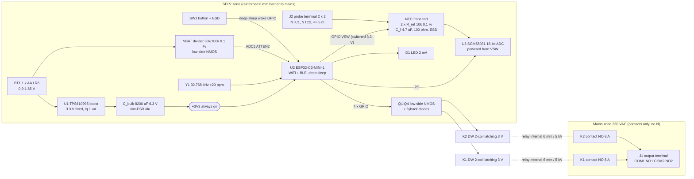

# Architecture: home-thermostat-v2 (stage 2)

Inputs: `requirements.yaml` (R1-R30), `conflicts.md` (C1-C5 resolved, C6-C8 new in this stage). Arithmetic: `notes/arch_budget.py` (not run: the command needs approval; every figure below is hand arithmetic with the same inputs). Datasheet facts: `notes/datasheets/*.md`. Rows marked "verify" are assumptions that stage 3 must confirm from the PDF.

## 1. Block diagram



## 2. Architecture choices (the numbers that decide)

### 2.1 Converter: boost type and always-on domain

The cell (0.9-1.65 V) is always below the 3.0-3.6 V rail, so the converter is a boost. LDO or buck are not possible.

| Option | Start / min Vin | Quiescent | Light-load efficiency | Current limit | Verdict |
|---|---|---|---|---|---|
| TPS610995 (TPS61099 3.3 V fixed) | 0.7 V | 0.4 uA (VIN) + 0.6 uA (VOUT) | up to 75 % at 10 uA | 0.8 A peak min | **chosen** |
| MCP1640-class | about 0.65 V | about 19 uA in PFM (verify) | low at 10 uA | about 0.8 A | rejected: Iq alone is about 2x the 10 uA R3 limit |
| TPS61291 bypass | - | nA in bypass | - | - | rejected: bypass gives Vout = Vin = 0.9-1.65 V; the ESP32-C3 needs 3.0 V, so the boost would run all the time anyway |
| Boost off in sleep + ultra-low-power always-on domain | - | - | - | - | rejected: the ESP32-C3 then cold-boots for every 2-min NTC sample: about 25 mA x 0.3 s x 3.3 V = 25 mJ x 720/day = 18 J/day = 208 uW, which is 93 % of the 224 uW R2 limit. A deep-sleep wake costs 4.1 mJ (section 4) |

Decision: TPS610995 always on, ESP32-C3 in deep sleep. Light-load efficiency is taken as 0.70 at 9 uA with Vin 1.2 V (TI states "up to 75 %" without a Vin; derated by 5 points). At 0.60 the total still passes (section 4.3).

Boost limit (assumption, verify in stage 4 SPICE): average input current at the limit = 0.6 A (0.8 A peak minus half the ripple), efficiency 0.80 at Vin 0.6-0.7 V.

- Cell 1.0 V EMF, 0.5 ohm (R4 end of life): Vin = 1.0 - 0.6 x 0.5 = 0.70 V; Iout max = 0.70 x 0.6 x 0.80 / 3.3 = **102 mA**.
- Cell 0.9 V EMF, 0.5 ohm (R8): Vin = 0.60 V; Iout max = **87 mA**.
- Physics limit at 1.0 V, 0.5 ohm with an ideal converter: 1.0^2 / (4 x 0.5) = 0.5 W in, 0.4 W out at 0.8 = 121 mA. No converter delivers 350 mA continuous from an end-of-life AA. The WiFi TX peaks therefore come from the bulk capacitor (section 2.2), and R1 as written (0-350 mA continuous at 0.9 V) cannot be met: conflicts.md C8.

### 2.2 Bulk buffer capacitor (R4, R7, R8)

| Case | Arithmetic | Result |
|---|---|---|
| R4: 350 mA, 5 ms step at 1.0 V, 0.5 ohm | deficit (350 - 102) mA x 5 ms = 1.24 mC | |
| C needed for 0.3 V droop, ESR 0.06 ohm | 1.24 mC / (0.3 - 0.248 x 0.06) V = 4.4 mF effective; with -20 % tolerance 5.4 mF nominal | 6800 uF minimum |
| Chosen 8200 uF (6.56 mF at -20 %) | droop 1.24 / 6.56 = 0.189 V + ESR 0.015 V = 0.204 V | rail 3.234 V (-2 % boost tolerance, verify) - 0.204 = **3.03 V >= 3.0 V** pass; nominal 3.10 V |
| R7: relay pulse, coil 22.5 ohm + 1.0 ohm series, 30 ms, cell 0.9 V EMF 0.5 ohm, MCU in light sleep (0.13 mA) | coil current 3.23 / 23.5 = 137 mA; deficit (137 + 0.1 - 87) mA x 30 ms = 1.51 mC; droop 1.51 / 6.56 = 0.230 V | rail 3.234 - 0.230 = **3.00 V**, coil 3.00 x 22.5 / 23.5 = **2.88 V** (window 2.7-3.3 V) pass, no margin on the rail at -2 % |
| Same with MCU active (20 mA) | deficit 1.51 + 0.6 = 2.11 mC, droop 0.32 V | rail 2.91 V: fails R1. Firmware rule: the MCU sits in light sleep (GPIO hold) during each 30 ms pulse; pulses never overlap; 200 ms between pulses (recharge 2.1 mC at 87 mA in 25 ms) |
| R8: 2 OFF pulses at cut-off | 2 x 13.6 mJ (rail, section 4) = 27.2 mJ from cell + buffer | <= 50 mJ reserve: pass |
| Buffer usable energy 3.3 to 3.0 V | 0.5 x 6.56 mF x (3.3^2 - 3.0^2) | 6.2 mJ |

Part class: 8200 uF 6.3 V low-ESR aluminium electrolytic, 12.5 mm diameter, 20-25 mm high (depth limit 38 mm: pass). Leakage: datasheet maximum 0.01 CV = 0.01 x 8200 x 6.3 = 517 uA, against 10 uA total for R3. The budget uses 2 uA measured after conditioning at 3.3 V (52 % of rated voltage). This is a verification-method conflict: conflicts.md C7.

### 2.3 MCU, radio and clock

| Option | Deep sleep | Cost (qty 10, estimate) | Notes |
|---|---|---|---|
| **ESP32-C3-MINI-1** | about 5 uA | about 2.3 USD | WiFi 4 + BLE 5 (R24 SoftAP or BLE), PCB antenna, CE/RED module (R20) |
| ESP32-C6-MINI-1 | about 7 uA (verify) | about +0.5 USD | LP core could read the I2C ADC without a full wake: saves about 27 uW, costs 2 uA (6.6 uW) and 0.5 USD; kept as the fallback if the sampling wake measures above 5.5 mJ (section 4.3) |

Clock (R18: 20 ppm at 25 C, 1 min/week offline over 0-40 C):

| Option | Drift worst case 0-40 C | Sleep current | Cost |
|---|---|---|---|
| **32.768 kHz crystal on ESP32-C3 XTAL_32K (GPIO0/1)** | 20 ppm + 0.034 ppm/C^2 x (25 C)^2 = 21 ppm at 0 C + 5 ppm load-cap mismatch = 46 ppm x 604800 s = **28 s/week** (limit 60 s) | about +1 uA allowance (verify) | about 0.15 USD + 2 caps |
| RV-3028-C7 / PCF85063 RTC chip | 1-3 ppm | 45 nA + ESP RC timer | 1.5-3 USD |

Decision: external crystal (cost weight 2; 28 s/week passes). NTP sync at every check-in (at most 60 min, R19/R21) resets the drift. After a battery swap without network, the time is unknown and both zones run at the fallback setpoint **18 C** until the first NTP sync (R19).

### 2.4 Relay and driver

| Option | Coil | Driver | Energy per pulse | Insulation (R9) | Verdict |
|---|---|---|---|---|---|
| **Panasonic DW 2-coil latching, 3 V** (24 x 10 x 18.8 mm, 1 Form A, 8 A 250 VAC) | 400 mW, 22.5 ohm, 133 mA | 2 low-side NMOS per relay (4 total, low-Vth SOT-23, AO3400 class) + 4 flyback diodes + 1.0 ohm series per relay | 3.3 V x 137 mA x 30 ms = 13.6 mJ | 6 mm creepage/clearance, 5 kV, 12 kV surge | **chosen**: about 0.15 USD of driver parts |
| DW 1-coil latching, 3 V | 200 mW | H-bridge per relay (4 FET or DRV8837 about 0.6 USD each) | 6.8 mJ | same | rejected: saves 20 x 6.8 mJ/day = 1.6 uW (0.6 % of budget), costs about 1 USD more |
| TE PE latching (20 x 10 x 10 mm) | 200 mW | - | - | 3.2 / 4 mm coil-contact: not reinforced | rejected (R9) |
| HF115F-L / G5RL 16 A | 400 mW | - | - | reinforced | rejected: 29 x 12.7 mm, does not fit with the AA (C3) |

Coil voltage at 3.3 V without a boost stage: rail 3.37 V max (+2 %) x 22.5 / 23.5 = 3.22 V; rail 3.00 V min x 22.5 / 23.5 = 2.87 V. Both inside 3.0 V +/-10 % (R7). The 1.0 ohm series resistor keeps the high end below 3.3 V. Pulse 30 ms = 2 x 15 ms max set time (R7). Gate pull-downs 100 k on all four gates so no coil fires during boot.

### 2.5 NTC front end and ADC

Topology (per probe): VSW (GPIO-switched 3.3 V, also the ADC supply) -> R_ref 10 k 0.1 % 25 ppm -> node N -> 100 ohm 1 % -> terminal -> 5 m cable -> NTC -> GND. ADC reads P = VSW and N; R_NTC = R_ref x N / (P - N) - 100 ohm - cable. Gain and reference errors cancel (ratio of two readings of the same ADC). C_f 4.7 uF X7R at node N: corner 1 / (2 pi x 4.46 k x 4.7 uF) = 7.6 Hz at 30 C (worst), 5.1 Hz at 10 C (R15 <= 10 Hz). Settling 9.2 tau (0.01 %) at 10 C = 9.2 x 6.69 k x 4.7 uF = 289 ms, spent with the ESP32-C3 in light sleep (0.13 mA). Channel 4 of the ADC reads an on-board 10 k / 10 k 0.1 % divider: runtime one-point calibration and fault check.

ADC choice:

| Option | Error per reading | Temperature error at 20 C | Channels | Cost |
|---|---|---|---|---|
| ESP32-C3 ADC1, nodes kept <= 1.3 V (47 k series), ATTEN2 | +/-10 mV calibrated (datasheet) | sensitivities 3.79 /V (N) and 2.11 /V (P): (3.79 + 2.11) x 10 mV = 5.9 % / 4.6 %/C = **1.28 C**: fails R14 | ADC1 = GPIO0-4; GPIO0/1 taken by the crystal; ADC2 unusable on C3; 3 left for P, N1, N2, VBAT (4 needed): fails | 0 |
| **SGM58031 (ADS1115 class), 16-bit, FSR +/-4.096 V, 128 SPS** | INL 1 LSB + noise 1 LSB (125 uV each), offset 3 LSB common (verify) | 0.015 C | 4 | about 0.6 USD |

### 2.6 Battery voltage (R5)

Divider 33 k (top, to cell +) / 100 k (bottom, via low-side NMOS gated by VSW) 0.1 % 25 ppm; ESP32-C3 ADC1 (GPIO3), ATTEN2 (0-1300 mV). Node max 1.65 x 100/133 = 1.241 V. With the NMOS off the node sits at Vbat (<= 1.65 V, inside the 3.3 V pin range) and draws only pin leakage. 100 nF at the node: tau 2.5 ms, read after 25 ms. Measured at rest (radio off), during the hourly wake. The external ADC is not used here: with VSW off its input would see the cell with VDD = 0 (back-powering through the input clamp).

Thresholds (to confirm with an LR6 low-drain discharge curve in stage 3): warning at 1.12 V rest, cut-off (both outputs OFF, R8) at 1.02 V rest. The 1.02 V cut-off is also the point where the boost still delivers the about 100 mA average a WiFi connect needs (section 2.1). The capacity between 1.02 V and 0.9 V lies inside the 0.8 derating of R2.

## 3. Power tree

| Rail | Source | Load typ | Load peak | Regulator | Efficiency / dropout |
|---|---|---|---|---|---|
| VBAT 0.9-1.65 V | 1 x AA LR6 | 8.9 uA x 3.3 / 1.2 / 0.70 = 35 uA (sleep) | 0.6 A average at boost limit (1.5 A peak max: R4) | - | cell resistance 0.15 ohm fresh, 0.5 ohm end of life (R4) |
| +3V3 always on | U1 TPS610995 from VBAT + C_bulk 8200 uF | 8.9 uA sleep; 25 mA sampling wake; about 100 mA WiFi average | 350 mA for 5 ms (TX, from C_bulk); 137 mA for 30 ms (coil) | synchronous boost, PFM at light load | 0.70 at 9 uA, 0.85 at 25-150 mA (Vin 1.2 V), 0.80 at Vin 0.6-0.7 V; dropout n/a (boost) |
| VSW 3.3 V switched | ESP32-C3 GPIO from +3V3 | 0 in sleep | 0.29 mA dividers + 0.26 mA ADC = 0.55 mA for 0.3 s per 2 min | GPIO high-side | drop about 20 mV at 0.55 mA (cancels: ratiometric) |
| Coil feed | +3V3 via 1.0 ohm per relay | 0 | 137 mA, 30 ms, one relay at a time | low-side NMOS | 0.14 V across 1.0 ohm, 7 mV across NMOS |

## 4. Power budget (R2, R3)

### 4.1 Sleep current at 3.3 V (R3 <= 10 uA)

| Item | uA | Source |
|---|---|---|
| ESP32-C3 deep sleep (RTC timer + memory) | 5.0 | datasheet (verify) |
| 32.768 kHz crystal oscillator allowance | 1.0 | assumption (verify by measurement) |
| TPS610995 Iq: 0.6 (VOUT) + 0.4 (VIN) x 1.2 / 3.3 | 0.75 | TI product page |
| C_bulk leakage at 3.3 V after conditioning | 2.0 | measurement target (datasheet max 517 uA: C7) |
| VBAT divider, NMOS off + GPIO3 leakage | 0.05 | allowance |
| 4 relay NMOS Idss at 3.3 V | 0.05 | allowance (pick parts with Idss spec at low Vds) |
| Button ESD diode (5 V working) at 3.3 V | 0.05 | pick <= 0.1 uA spec |
| Probe ESD diodes, NTC dividers, ADC | 0 | unpowered (VSW low) |
| **Total** | **8.90** | <= 10 uA: pass, 1.1 uA margin |

### 4.2 Average power

| Item | Rail arithmetic | Rail uW | Efficiency | Cell uW |
|---|---|---|---|---|
| Sleep | 8.90 uA x 3.3 V | 29.4 | 0.70 | 42.0 |
| NTC sampling, 720/day | per wake: boot+run 25 mA x 40 ms x 3.3 V = 3.30 mJ; excitation 0.29 mA x 0.3 s x 3.3 V = 0.29 mJ; light-sleep settle 0.13 mA x 0.3 s x 3.3 V = 0.13 mJ; re-wake 25 mA x 5 ms x 3.3 V = 0.41 mJ; total 4.13 mJ x 720 / 86400 | 34.4 | 0.85 | 40.5 |
| WiFi, 24 hourly + 2 button wakes | 26 x 0.5 J / 86400 | 150.5 | 0.85 | 177.0 |
| Relay pulses, 20/day | 3.3 V x 137 mA x 30 ms = 13.6 mJ x 20 / 86400 | 3.2 | 0.85 | 3.7 |
| LED (R23 limit 35 s/day at 2 mA) | 2 mA x 3.3 V x 35 s / 86400 | 2.7 | 0.85 | 3.1 |
| Battery measurement | 12 uA x 25 ms per hour | 0.0 | - | 0.0 |
| **Total** | | **220.1** | | **266.3** |

### 4.3 Runtime and R2 check

- R2 limit is 223.6 uW at the rail with an 0.80 converter efficiency built in, so the comparable figure is cell power x 0.80 = 266.3 x 0.80 = **213.0 uW <= 223.6 uW: pass** (4.7 % below the limit, 19.0 % below the 263 uW usable). The raw rail sum (220.1 uW) is also below the limit.
- Runtime: usable 3.0 Wh x 0.8 derating = 2.4 Wh; 2.4 Wh / 266.3 uW = **9012 h = 12.3 months** (R2: >= 10 months = 7300 h).
- Sensitivities:
  - WiFi at boost efficiency 0.80 instead of 0.85: cell 277.4 uW, x 0.8 = 221.9 uW: pass (11.9 months).
  - Sleep efficiency 0.60 instead of 0.70: +7.0 uW cell, 218.6 uW: pass.
  - Sampling wake energy limit: (223.6 / 0.8 - (266.3 - 40.5)) x 0.85 x 86400 / 720 = **5.5 mJ per wake** (about 66 ms at 25 mA awake). A full ESP-IDF boot of 80-100 ms would break the R2 limit (life still about 11 months). Firmware target: fast deep-sleep wake (skip image validation, no boot log), ADC at 860 SPS. If stage 4 measures more than 5.5 mJ, fall back to the ESP32-C6 LP core (section 2.3).
  - WiFi wake limit: unchanged 0.52 J (conflicts.md C1). The 0.8 x cell figure gives (223.6 / 0.8 - 266.3 + 177.0) x 0.85 x 86400 / 26 = 0.53 J.

## 5. Signal chain budgets

### 5.1 NTC temperature, R14 (+/-0.5 C, 10-30 C)

NTC 10 k B3950: R(10 C) = 20.17 k, R(20 C) = 12.54 k, R(30 C) = 8.04 k (B equation). Slope alpha = B / T^2 = 4.93, 4.60, 4.30 %/C. Node N = 3.3 x R / (R + 10 k) = 2.206, 1.836, 1.471 V. Ratio sensitivity: dr/r = eN x P / (N (P - N)) - eP / (P - N), coefficients kN = 1.37 / 1.23 / 1.23 per V and kP = 0.91 / 0.68 / 0.55 per V.

| Block | Error source and arithmetic | 10 C | 20 C | 30 C |
|---|---|---|---|---|
| NTC | R25 1 %: 1 % / alpha | 0.203 | 0.218 | 0.233 |
| NTC | B 1 %: 39.5 K x abs(1/T - 1/298.15) / alpha | 0.142 | 0.049 | 0.051 |
| R_ref | 0.1 % + 25 ppm x 15 C = 0.1375 % / alpha | 0.028 | 0.030 | 0.032 |
| ADC (gain) | cancels in the ratio | 0 | 0 | 0 |
| ADC (INL + noise) | 2 LSB x 125 uV on each reading: (kN + kP) x 250 uV | 0.012 | 0.010 | 0.010 |
| ADC (offset, common) | 3 LSB = 375 uV x abs(kN - kP) | 0.003 | 0.004 | 0.006 |
| ADC total | (sum of the two rows above, in % / alpha) | 0.015 | 0.015 | 0.016 |
| Cable + series R | 2 x 0.5 ohm cable + 1 ohm (1 % of 100 ohm), 2 ohm / R / alpha | 0.002 | 0.004 | 0.006 |
| ESD leakage at node N | 0.1 uA x (R_ref par R) x kN / alpha | 0.019 | 0.015 | 0.013 |
| Self-heating | N^2 / R = 0.24-0.27 mW, 1.5 mW/C (probe, verify), 0.3 s on / 10 s thermal tau | 0.005 | 0.005 | 0.005 |
| Resolution (R16) | 125 uV / 37.4 mV/C (inside the ADC noise row, not added again) | (0.003) | (0.003) | (0.003) |
| **Worst-case sum** | | **0.413** | **0.336** | **0.356** |
| **RSS** | | 0.25 | 0.23 | 0.24 |

Pass: the worst case is 0.413 C <= 0.5 C at 10 C. The NTC itself is 84 % of the error; the electronics use 0.07 C. Gain: ratio 1 (ratiometric). Offset: removed by the on-board calibration divider (channel 4). Noise: thermal noise of 5.5 k in 7.6 Hz = sqrt(4 kT R B) = 30 nV, negligible against 125 uV. Bandwidth: 5-7.6 Hz (R15); 50 Hz pickup on 5 m cable attenuated by 1 / sqrt(1 + (50/7.6)^2) = 0.15 (-16.5 dB) before the ADC filter. Resolution (R16): 0.003 C per LSB at 20 C (limit 0.1 C). Sample period: 2 min, both probes in one wake (R16).

Rule for part selection: ESD diodes on the probe nodes need leakage <= 0.1 uA at 3.3 V; a 1 uA part adds 0.19 C at 10 C and breaks the budget.

### 5.2 Battery voltage, R5 (<= 20 mV over 0.9-1.65 V)

| Block | Arithmetic | mV at the cell |
|---|---|---|
| ESP32-C3 ADC, ATTEN2, calibrated | +/-10 mV / k (k = 100/133 = 0.752) | 13.3 |
| Divider ratio, 2 x 0.1 % | 1.65 V x (1 - k) x 0.2 % | 0.8 |
| Divider TCR, 25 ppm x 15 C each | 1.65 V x (1 - k) x 2 x 25 ppm x 15 | 0.3 |
| Pin leakage, 50 nA x 24.8 k Thevenin | 1.24 mV / k | 1.7 |
| NMOS Rds_on 0.05 ohm in 100 k | 0.00005 % | 0.0 |
| Noise after 64-sample average | allowance | 0.5 |
| **Worst-case sum** | | **16.6 mV <= 20 mV: pass** |

## 6. Isolation zoning and floorplan (R9, R10, R12, R22)

Rules: mains to SELV 6.0 mm creepage and clearance (R9), output 1 to output 2 3.0 mm clearance and 2.5 mm creepage (R10). The relay provides its own 6 mm coil-to-contact distance, so the barrier passes through the relay bodies. Antenna at least 10 mm from relays and battery, no copper under it (R22).

Sketch (top view, 65 x 42 mm, components on top):

```
x: 0        13.2   25     31        44      57     65
y=0  +--------+------+-----+---------+-------+------+
     | ANT    |      |  6  | K1 cont.| K2 c. |  J1  |   mains copper: K1/K2 contact ends
     | keep-  | Cbulk|  mm | ======= | ===== | 4p   |   (y 0-8) + bus + J1 (x 57-65, y 0-20)
     | out    | U1 L |barr.| K1 body | K2    | 5.0  |
y=17 | ESP32- | Y1   |     | (coil   | body  | mm   |   barrier: x 25-31 and y 20-26 (x 44-65)
     | C3-MINI|  U3  |     |  end)   |       |      |   K1-K2 gap 3 mm (R10)
y=26 +--+-----+------+-----+---------+-------+------+
     |J2|  AA cell on end clips (57 x 16), x 8-65,   |   SELV; SMD parts <= 1.2 mm high under
     |2x|  SMD: drivers, AFE, divider under the cell |   the cell between the clips
y=42 +--+-------------------------------------------+
```

| Area | Arithmetic | mm2 |
|---|---|---|
| Mains copper (K1/K2 contact ends 2 x 10 x 8, J1 10 x 20, bus 30 x 4) | 160 + 200 + 120 | 480 |
| 6 mm barrier (part of it lies under the relay bodies and is counted again in the coil halves: conservative) | (26 + 10) mm boundary x 6 mm | 216 |
| Relay coil halves (SELV) | 2 x 10 x 16 | 320 |
| ESP32-C3-MINI-1 + antenna keep-out | 13.2 x 16.6 + keep-out | 350 |
| AA holder | 57 x 16 | 912 |
| C_bulk 12.5 mm | 13.5 x 13.5 | 182 |
| J2 probe terminal, 4-pole 3.5 mm | 14 x 8 | 112 |
| Other SELV parts (boost + L 48, ADC 40, AFE 60, drivers 70, crystal 15, button + LED 55, divider 20, programming pads 30, decoupling 10) + 15 % routing | 348 x 1.15 | 400 |
| **Total demand** | | **2972** |
| Board 65 x 42 | | 2730 |
| **Balance, single-sided** | | **-242 (does not close)** |
| Area under the cell between end clips usable for parts <= 1.2 mm (45 x 12) | | +540 |
| **Balance with parts under the cell** | | **+298** |

The stage 1 estimate (208 mm2 free, C3) did not include the bulk capacitor (182 mm2), the external ADC, the 24 mm DW length or routing. New conflict C6 records this; the proposed fix (end clips, parts under the cell) has no BOM cost and no requirement change. Antenna distances in the sketch: antenna to K1 contacts about 25 mm, to cell 13 mm (R22: 10 mm). J1 pad edge (y 19) to cell (y 26) 7 mm (R9: 6 mm).

## 7. Interface list

| Ref | Connector | Pins | Levels | Protection |
|---|---|---|---|---|
| J1 | 4-pole screw terminal, 5.0 mm pitch, >= 10 A 300 V, 0.5-1.5 mm2 | COM1, NO1, COM2, NO2 | 230 VAC, 5 A per output, voltage-free | 6 mm barrier to SELV, 3 mm between outputs; traces >= 2.5 mm wide (1 oz) for 5 A; no snubber (RC leakage would keep thermoelectric heads warm); installation MCB protects the line (instructions) |
| J2 | 4-pole screw or push terminal, 3.5 mm pitch | NTC1, GND, NTC2, GND | 0-3.3 V, SELV, about 0.3 mA only while sampling | ESD diode per signal line (IEC 61000-4-2 +/-8 kV air / +/-4 kV contact, leakage <= 0.1 uA), 100 ohm series, 4.7 uF filter; >= 6 mm from mains |
| BT1 | AA end clips (2 x, hand-solder) | +, - | 0.9-1.65 V | polarity by clip shape and silkscreen; no series diode (0.3 V drop = 30 % of a 1 V cell); 22 uF MLCC at the boost input takes contact ESD; reachable behind the front plate without opening the mains cover (R11) |
| SW1 | tactile switch 6 x 6 | GPIO (deep-sleep wake), GND | 3.3 V, internal pull-up | ESD diode (<= 0.1 uA at 3.3 V), 1 k series |
| D1 | LED 0603 | GPIO sink, 680 ohm | (3.3 - 2.0) V / 680 ohm = 1.9 mA | - |
| TP | programming pads | 3V3, GND, EN, GPIO9 (boot), USB D+/D- (GPIO18/19) | 3.3 V | SELV, not reachable in use |
| ANT | module PCB antenna | - | 2.4 GHz, >= 15 dBm module (R20) | keep-out per module datasheet |

Tentative GPIO plan (pin numbers from `hwflow lib show` in stage 4; strapping pins GPIO2/8/9 and UART TX GPIO21 checked against boot glitches there): GPIO0/1 crystal, GPIO3 VBAT, GPIO5 button wake, GPIO10 VSW, GPIO6/7 I2C (pull-ups to VSW), GPIO2 LED (LED to 3V3 keeps the strap high), GPIO4 and GPIO20 K1 set/reset; K2 set/reset need two more boot-safe pins (GPIO8 with ROM-log check, or GPIO21 with ROM log disabled by eFuse). ESP32-C3 EN: RC delay longer than the C_bulk charge time (44.6 mJ at about 0.3 W = 0.15 s), e.g. 100 k x 4.7 uF = 0.47 s.

## 8. Compliance checklist (R27)

| Item | How it is met |
|---|---|
| EN 60730-1 / -2-9 insulation | reinforced 6 mm mains-SELV (R9), basic 3 mm between outputs (R10), relay 6 mm / 5 kV / 12 kV surge coil-contact, fixed cover over mains (R11) |
| No mains supply | contacts and J1 only, no N, no AC/DC (R30) |
| RED: EN 300 328, EN 301 489-1/-17, EN 62479 | pre-certified ESP32-C3-MINI-1 with integrated antenna, used per its keep-out rules; ESD on button and probes (R26) |
| EN 18031-1 | firmware: secure boot + flash encryption, TLS to broker or LAN-only broker, no default passwords (firmware task, outside hardware flow) |
| RoHS | RoHS parts only (checked in stage 3 BOM) |
| EU battery regulation 2023/1542 | user-replaceable AA without tools beyond the front plate; battery type marked |

## 9. Cost estimate (R28, qty 10, to be replaced by the stage 3 BOM)

ESP32-C3-MINI-1 2.3 + TPS610995 0.9 + inductor 0.1 + 8200 uF 0.25 + 2 x DW relay 6.0 + SGM58031 0.6 + crystal 0.15 + FETs/diodes 0.2 + J1 0.5 + J2 0.3 + AA clips 0.6 + ESD x 3 0.15 + passives 0.5 + button/LED 0.15 + PCB 0.5 + (assembly setup + stencil + extended-part fees, about 35 USD) / 10 3.5 = **about 16.7 USD <= 25 USD**. DW relays may not be JLCPCB stock: hand-solder (R29).

## 10. Open items for stage 3/4

- Verify from PDFs: TPS610995 Vout tolerance and current limit max (R4 <= 1.5 A), ESP32-C3 deep sleep with XTAL_32K, SGM58031 INL/offset, DW 3 V 2-coil part number, electrical life at 5 A and inductive rating (R6), DW reinforced approval.
- SPICE (stage 4): R4 step and R7 pulse with the boost model, 8200 uF, cell 0.5 ohm.
- Firmware targets: sampling wake <= 5.5 mJ, WiFi wake <= 0.52 J, light sleep during relay pulses and NTC settling.
- C6 (area), C7 (C_bulk leakage), C8 (R1 load range) in conflicts.md.
