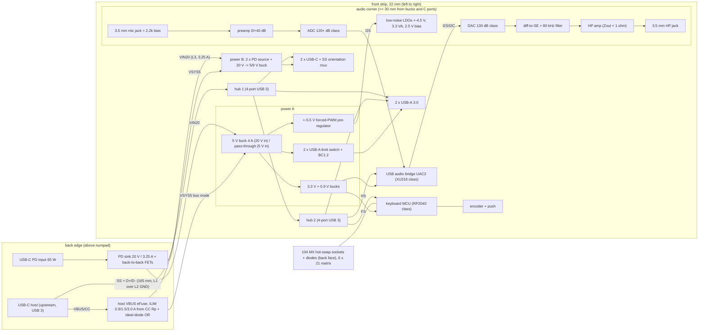

# Architecture, mechanical-keyboard-usb-audio-hub (stage 2)

Part names below are candidate classes for the parts stage. Every current is a class estimate unless a source is
given. The parts stage replaces each estimate with a datasheet value and re-runs these budgets. Sources used here:
GL3523S 0.86 W with 4 SuperSpeed downstream ports active (Genesys/Arrival note), ES9039Q2M 130 dB DNR and -120 dB
THD+N (ESS/Mouser product page), FR4 0.4 dB/inch at 2.5 GHz and a -20 dB Gen 1 channel at 2.5 GHz (TI TUSB522P
datasheet and E2E). The JLC04161H-7628 stack-up is 0.2104 mm prepreg L1-L2, er 4.4, 1 oz outer copper.

## 1. Block diagram

Hub topology: hub1 DS1 = USB-C1, DS2 = USB-C2, DS3 = USB-A1, DS4 = hub2. Hub2 DS1 = USB-A2, DS2 = audio bridge (high speed),
DS3 = MCU (full speed), DS4 spare. That gives 7 downstream ports, R4 needs 6.

## 2. Architecture choices

| choice | options | numbers | decision |
|---|---|---|---|
| hub | one 7-port USB 3 hub (USB5807 class) / two cascaded 4-port hubs (GL3523 class) | 7-port: ~$9, ~1.2 W (est.); 2 x 4-port: 2 x ~$1.5, 0.86 W + ~0.5 W | cascade. It is cheaper by ~$6 (cost weight 2), the power is about the same, and the hub chips are in stock at JLC. |
| internal devices | separate MCU + bridge / keyboard HID inside the bridge (composite) | composite saves the MCU (25 mA, $1.5) but still needs 5 ports, so 2 hubs either way; R4 asks for 2 internal ports | separate (R4 as written) |
| USB-C SS orientation | hub with Type-C mux / external 2:1 mux per C port | 2 C ports downstream + 1 upstream; ~$0.7 each (est.) | external mux on the 2 downstream C ports; upstream uses the hub's native Type-C if the chosen hub has it, otherwise a 3rd mux (adds +$2-3 to C9) |
| 3.3 V / 0.9 V | LDO from 5 V / buck | 3.3 V at 55 mA: LDO draws 55 mA from 5 V, buck draws 41 mA (88 %). 0.9 V at 150 mA (est.): LDO from 3.3 V draws 150 mA, buck draws 32 mA | buck for both. In bus mode every mA counts (R19). |
| audio +- rails | charge pump in the audio corner / inductive forced-PWM pre-regulator 80 mm away + LDOs | a charge pump inside the audio region breaks R35 (switch node < 30 mm) | forced-PWM +-5.5 V pre-regulator in power A, then low-noise LDOs +-4.5 V in the audio corner |
| C-port converters | buck-boost (works from 5 V host) / buck from 20 V + bypass FET in bus mode | buck-boost at 5 V in idle forced PWM costs 10-20 mA each (est.) from the 900 mA budget | buck from VIN20 (20 W at 94 %); in bus mode the buck is off and VSYS5 goes to the port through the PD source VBUS switch |
| construction | single face / double face / stacked | R27 puts the sockets on the back, so single face is rejected. A stacked front daughterboard adds ~$3 and 5-8 mm of depth under the strip; isolation is by distance, not mains | double |

## 3. Power tree

| rail | source | load typ / peak | regulator | efficiency / dropout |
|---|---|---|---|---|
| VIN20 (PD mode) | 65 W PD adapter via the sink + back-to-back FETs | 3.18 A / 3.22 A at 20 V | PD sink controller (CH224 class), FET 2 x ~10 mOhm | 0.10 W FET + 0.40 W copper (budget L4) |
| VSYS5_HOST (bus mode) | host VBUS via eFuse (ILIM 0.9 / 1.5 / 3.0 A, set from CC Rp) | <= 0.9 / 1.5 / 3.0 A | eFuse ~60 mOhm + ideal diode | 54 mV at 0.9 A |
| 5V_SYS | buck 20 -> 5.1 V 4 A (PD mode); pass-through from VSYS5_HOST (bus mode) | 0.55 A internal + 3.0 A USB-A | sync buck, forced PWM >= 400 kHz, shielded L | 92 % (est. class) |
| VBUS_C1, VBUS_C2 | PD source buck 20 -> 5/9 V (PD mode); VSYS5 via the VBUS switch (bus mode) | 3.0 A at 5 V / 2.22 A at 9 V | sync buck + PD source controller, forced PWM | 94 % at 9 V/20 W (est. class) |
| VBUS_A1, VBUS_A2 | 5V_SYS via limit switch (ILIM 1.7 A PD mode, 0.1/0.25/0.5 A bus mode) | 1.5 A each | current-limit switch ~70 mOhm | 105 mV at 1.5 A |
| 3V3_D | 5V_SYS buck | 55 / 80 mA | buck | 88 % |
| 0V9_CORE (bridge) | 5V_SYS buck | 150 / 200 mA (est.) | buck | 85 % |
| hub 3.3 / 1.x | hub internal regulators from 5V_SYS | in the hub figure | hub on-chip | - |
| +-5.5V_PRE | 5V_SYS, forced-PWM boost + inverter | 26 mA q + 44 mA signal per rail | inductive, >= 400 kHz | 85 % (est.) |
| +-4.5V_A (op-amps) | +-5.5V_PRE | 26 / 70 mA per rail | low-noise LDO, PSRR >= 70 dB at 10 kHz, noise <= 1 uVrms | 1.0 V headroom |
| 3V3_A (DAC, ADC analog) | 5V_SYS via CLC filter | 30 / 40 mA | low-noise LDO | 1.7 V headroom |
| 2V5_BIAS (mic) | 3V3_A + RC 10 Hz | 1 mA | LDO/reference | - |

## 4. Power budget

### 4.1 Internal loads (5 V equivalent)

| load | typ mA | peak mA | basis |
|---|---|---|---|
| hub1, 4 SS ports active | 172 | 200 | 0.86 W / 5 V (GL3523S class); peak +15 % (est.) |
| hub2, 1 SS port + 2 HS active | 100 | 172 | ~0.5 W est. (2 of 5 SS PHYs); peak = hub1 typ |
| MCU + flash, 3.3 V buck | 25 | 40 | RP2040 class at 125 MHz, USB FS (est.) |
| audio bridge + flash + 2 clocks, 3.3/0.9 V bucks | 68 | 90 | ~0.30 W est. / 0.88 / 5 V |
| DAC (3V3_A LDO) | 18 | 25 | est. class |
| ADC (3V3_A LDO) | 20 | 25 | est. class |
| op-amp quiescent, +-5.5 V pre-reg | 67 | 75 | 4 duals x ~6.5 mA: 2 x 5.5 V x 26 mA / 0.85 / 5 V |
| headphone signal, 1 Vrms into 32 Ohm, both channels (R29 level) | 73 | 73 | 2 ch x 2 x 5.5 V x (1.414 / 32) / pi = 0.31 W / 0.85 / 5 V |
| (same at 2 Vrms into 32 Ohm, single-gain output) | (146) | (146) | 0 dBFS gives 2 Vrms into any load when the gain serves 300 Ohm |
| mic bias, power-path and CC logic, encoder | 6 | 6 | est. |
| **total** | **549** | **706** | 2 Vrms into 32 Ohm: 622 / 779 |

### 4.2 Bus mode (no PD input)

| host | budget | internal | left for 4 ports | per port, all 4 loaded | requirement |
|---|---|---|---|---|---|
| 900 mA (USB 3 port) | 900 | 549 typ / 706 peak | 351 / 194 | 88 / 49 mA | R19 >= 100 mA: **fails by 12 mA typ, 51 mA peak** |
| USB-C 1.5 A | 1500 | 549 / 706 | 951 / 794 | 238 / 199 mA | R21 >= 250 mA: **fails by 12 / 51 mA** |
| USB-C 3.0 A | 3000 | 549 / 706 | 2451 / 2294 | 613 / 574 mA, capped at 500 | R21 >= 500 mA: passes |

R19 caps the internal loads at 500 mA (900 - 4 x 100). The estimate is 549 mA typ and 706 mA peak, with a spread of about +-20 % because the hub and bridge figures are not from datasheets yet. This is conflict C12. Ports are limited per port. The eFuse (trip <= 0.9 / 1.5 / 3.0 A) is the backstop, so a port overload never resets the keyboard or the audio. The per-port limit is (host - internal) / 4.

### 4.3 PD mode (65 W input)

| load | out W | efficiency | in W |
|---|---|---|---|
| 2 x USB-C at 9 V / 2.22 A | 40.0 | 94 % | 42.55 |
| PD source VBUS FETs, 2 x 3 A^2 x 16 mOhm (5 V/3 A case) | - | - | 0.29 |
| 2 x USB-A at 5 V / 1.5 A | 15.0 | 92 % | 16.30 |
| USB-A limit switches 2 x 1.5^2 x 70 mOhm | - | - | 0.32 |
| internal 549 mA typ / 779 mA peak at 5 V (2 Vrms into 32 Ohm) | 2.75 / 3.90 | 90 % | 3.05 / 4.33 |
| sink FETs + VIN20 copper (3.2 A) | - | - | 0.50 |
| **total** | | | **63.0 typ / 64.3 peak <= 65 W** (margin 2.0 / 0.7 W) |

R9 holds by the estimate, but the margin is thin at peak. A C-port buck at 92 % instead of 94 % costs +1.0 W and leaves -0.3 W at peak. The parts stage must pick converters >= 93 % at 20 W. Otherwise the PD sources must cap the C ports at 2 x 18 W when both A ports are loaded (risk, see section 9). The host draws nothing in PD mode (ideal-diode OR, PD input has priority).

Thermal (R16): losses are ~2.4 W in power B (two C bucks) and ~1.5 W in power A, spread over 1000-2200 mm2 of 4-layer board. That is a rise of about 20-25 K at 40 C ambient (est.), so the parts stay inside their ratings. The parts stage checks it with theta-JA.

## 5. Audio signal-chain budget

### 5.1 Headphone output (R10, R22, R29-R32), A-weighted 20 Hz - 20 kHz, max volume, digital silence

Gain structure: the DAC gives 2 Vrms differential full scale, the diff-to-SE stage has gain 1, and the amp is a gain-1 buffer. 0 dBFS = 2 Vrms at the jack. That is 126 dB re 2 Vrms = 120 dB re 1 Vrms, so the floor is 1.0 uVrms.

| block | noise, uVrms A-wtd | basis |
|---|---|---|
| DAC | 0.71 | 129 dB re 2 Vrms (1 dB under the 130 dB class figure): 2 x 10^(-129/20) |
| diff-to-SE + 2nd-order 80 kHz filter | 0.45 | 1.1 nV/rtHz op-amp, 200 Ohm network: ~4.2 nV/rtHz at the output x sqrt(20 kHz) x 0.79 (A-wtd) |
| headphone amp (gain 1) | 0.31 | 2.8 nV/rtHz class x 141 x 0.79 |
| DAC reference / AVCC noise at silence | 0.10 | allocation |
| LDO noise through the op-amp PSRR (1 uV x -100 dB) | 0.01 | |
| output series R + TVS (<= 1 Ohm) | < 0.01 | thermal noise of 1 Ohm |
| **intrinsic RSS** | **0.90** | limit 0.944 (C11), margin 0.04 |
| coupled: host VBUS 100 mV through 150 dB (CLC 20 + LDO 70 + amp 60) | 0.003 | C11 |
| coupled: converter ripple >= 400 kHz (out of band; intermod) | 0.05 | allocation |
| coupled: key-matrix scan (<= 0.025 fF effective, 5 mm rule) | 0.10 | allocation |
| coupled: bridge USB frame current via the single-point ground | 0.20 | allocation |
| coupled: magnetic, inductors >= 30 mm | 0.15 | allocation |
| **coupled RSS** | **0.28** | limit 0.33 |
| **total** | **0.94** | limit 1.0 uVrms |

- Gain: 0 dB analog, digital volume in the DAC. Offset: DC coupled with a DC servo, <= 1 mV at the jack. Bandwidth: 2nd-order Butterworth at 80 kHz loses 0.017 dB at 20 kHz. DAC digital filter ripple is allocated <= 0.03 dB. Deviation is <= 0.05 dB against +-0.1 dB (R31). Zout is 0.47 Ohm series + amp ~0.05 Ohm, so <= 1 Ohm (R32).
- THD+N (R30): DAC -120 dB (class figure) RSS amp -115 dB (class, 32 Ohm/1 Vrms) = -113.8 dB, which meets -106 dB.
- Headroom (R29): 2.83 V peak + 0.5 V needs +-3.33 V. The op-amp swing on +-4.5 V at 88 mA peak is ~+-3.7 V (class), a margin of 0.37 V.
- Intrinsic margin is only 0.04 uV. The DAC choice dominates (0.71 of 0.90). A DAC with < 129 dB DNR re 2 Vrms does not fit.

### 5.2 Mic input (R11, R33), input-referred, A-weighted

| block | min gain (1 Vrms FS) uV | max gain (+40 dB, 10 mV FS) uV | basis |
|---|---|---|---|
| source 150 Ohm // 2.2 k bias (140 Ohm thermal) | 0.17 | 0.17 | 1.52 nV/rtHz |
| preamp (1 nV/rtHz class) + gain network | 0.28 | 0.12 | |
| ADC, 122 dB re 2 Vrms class, driven at gain 2 / 200 | 0.79 | 0.008 | 1.59 uV / gain |
| bias supply (LDO + 10 Hz RC) through 150/2350 divider | < 0.01 | < 0.01 | |
| **RSS** | **0.86** (DR 121.3 dB) | **0.21** (EIN -133.5 dBV) | limits 0.944 / 1.0 |

## 6. USB 3 signal-integrity budget (R5)

Stack-up JLC04161H-7628: L1 signal / 0.2104 mm 7628 prepreg (er 4.4) / L2 GND / 1.065 mm core / L3 power / prepreg / L4 (sockets). Edge-coupled microstrip on L1, Hammerstad: w = 0.28 mm, s = 0.20 mm gives Z0 57.4 Ohm and Zdiff 92.7 Ohm bare. Solder mask takes off ~2-3 Ohm, so the pair is ~90 Ohm (R5 band 81-99 Ohm). The JLC impedance calculator confirms it at layout.

Loss at 2.5 GHz: dielectric 0.20 dB/in (Df 0.02, eeff 3.27) + conductor and roughness ~0.2 dB/in = 0.40-0.45 dB/in. TI gives 0.4 dB/in for FR4. Use 0.45 dB/in (0.18 dB/cm).

| link | length | trace dB | connector / vias / AC cap / TVS / mux dB | total dB | board allocation | margin |
|---|---|---|---|---|---|---|
| host socket -> hub1 (down the nav/numpad channel, L1 only, no via) | 165 mm | 2.9 | 0.5 / 0 / 0.1 / 0.2 / - | 3.7 | ~7 dB (est.: 20 dB channel - cable ~6 dB - far board ~6.5 dB) | 3.3 |
| hub1 -> USB-C2 (worst downstream) | 60 mm | 1.1 | 0.5 / 0.2 / 0.1 / 0.2 / 0.6 | 2.7 | ~7 dB | 4.3 |
| hub1 -> hub2 -> USB-A2 | 15 + 40 mm | 1.0 | 0.5 / 0.2 / 0.2 / 0.2 / - | 2.1 | ~7 dB | 4.9 |

The hub vendor layout guide length limit (typically 5-8 in for Gen 1) is checked at the parts stage. The upstream run of 165 mm = 6.5 in is the one to watch. Intra-pair skew must be <= 0.13 mm (5 mil, typical vendor rule). The route runs in the 12 mm hole-free channel between the nav cluster and the numpad (x ~356 mm) over unbroken L2. Matrix traces keep 3 x w away.

## 7. Interfaces

| connector | pins | levels | protection |
|---|---|---|---|
| J host USB-C (back) | 24: VBUS, CC1/2, D+/D-, 2 SS pairs, SBU (nc), GND | 5 V VBUS; USB 2 HS; 5 Gb/s CML | VBUS TVS (>= 6 V standoff), D+/D- TVS, SS TVS <= 0.3 pF, CC TVS; eFuse |
| J PD in USB-C (back) | VBUS, CC1/2, GND (D+/D- unused) | 5-20 V | 24 V TVS, CC TVS (20 V tolerant), back-to-back FETs |
| J USB-C1/C2 (front) | 24 | 5 / 9 V VBUS, CC, HS, SS | VBUS TVS 12 V class, CC/D/SS TVS (SS <= 0.3 pF), PD source OCP 3.3 A (R6) |
| J USB-A1/A2 3.0 (front) | 9: VBUS, D+/D-, SSRX, SSTX, GND, GND_DRAIN | 5 V | VBUS TVS, D/SS TVS, limit switch 1.7 A (R6) |
| J headphone 3.5 mm (front) | T, R, S (+ detect) | +-2.83 V peak | low-C, low-leakage TVS per contact (in the R10/R32 sims), series 0.47 Ohm |
| J mic 3.5 mm (front) | T (mic + bias), R, S | 2.5 V bias via 2.2 k, 10 mV-1 V | low-leakage TVS, RF filter (100 Ohm + 470 pF) |
| encoder (front) | A, B, push, GND | 3.3 V GPIO | metal shaft to chassis GND / TVS, RC debounce |
| switch matrix | 6 rows x 21 cols, 104 keys + diodes | 3.3 V GPIO | internal, no ESD (the plate is not a cable port) |

## 8. Layout budgets (move to `budgets:` in design.yaml at the circuit stage, when pads exist)

| id | path (pad to pad) | current | limit | source arithmetic |
|---|---|---|---|---|
| L1 | host eFuse OUT -> USB-A/C port switch IN, VBUS + GND (back to front, ~150 mm on L3/L2) | 0.9 A | 100 mV | R19: 4.45 V min - (4.75 V host - 0.135 V cable 2 x 75 mOhm x 0.9 A - 0.054 V eFuse - 0.010 V port switch at 0.1 A = 4.551 V) = 101 mV |
| L2 | PD source buck output cap -> USB-C VBUS/GND pins | 3.0 A | 100 mV | R7: 5 % of 5 V = 250 mV - 75 mV setpoint accuracy (1.5 %) - 48 mV VBUS FET (3 A x 16 mOhm) = 127 mV, rounded down |
| L3 | 5 V buck output -> USB-A VBUS/GND pins (via limit switch) | 1.5 A | 150 mV | R8: (5.10 V set - 1.5 % = 5.02 V) - 0.105 V switch - 4.75 V = 170 mV, rounded down |
| L4 | PD input VBUS pin -> C bucks and 5 V buck VIN, + GND return | 3.2 A | 120 mV | R9 power margin: 0.40 W of copper loss allowed (63.0 W estimate + 0.4 W <= 65 W at peak with 0.3 W left) |
| L5 | audio LDO outputs -> op-amp supply pins | 0.07 A | decap <= 4 mm (board default) | R10 PSRR path |
| L6 | audio ground: single-point join to system GND; no charge return in the audio region | - | 0 A charge current through the audio region | R22, C11 (0.33 uOhm impossible in copper) |

## 9. Floorplan (design.yaml) and risks

Board 440 x 152 mm, 4 layers, double-sided. The key field is 434 x 126 mm (6.5 u rows, F-row gap). The front strip is 22 mm deep (R24 <= 25). Stage 4 (real parts, every stage-2 placeholder replaced by its pass-B group; pwr_ctl joins pd_sink in back_conn): regions sized to <= 70 % courtyard fill. Left to right along the strip (y 130-152; audio y 135.5-152):

| region | x (mm) | courtyard mm2 / area | fill |
|---|---|---|---|
| audio (jacks, DAC/ADC, amps, LDOs) | 3-123 | 1348 / 1980 | 68 % |
| knob | 125-145 | 255 / 440 | 58 % |
| bridge + MCU | 147-187 | 539 / 880 | 61 % |
| power A (5 V, 3.3/0.9 V, +-5.5 V, USB-A switches) | 189-245 | 785 / 1232 | 64 % |
| USB-A | 247-290 | 545 / 946 | 58 % |
| hubs | 292-330 | 428 / 836 | 51 % |
| USB-C | 332-358 | 273 / 572 | 48 % |
| power B (2 PD sources) | 360-437 | 968 / 1694 | 57 % |
| back_conn (host + PD in, y 0-24) | 360-437 | 684 / 1848 | 37 % |

The back connectors sit at x 360-437, y 0-24, in the switch-free space above the numpad. The host and PD sockets are 20 mm apart (R20 <= 25). R35: the audio region is 66 mm from power A (nearest switch node, aux_pm/buck_dig), 209 mm from the USB-C ports, 237 mm from power B, 5.5 mm from the matrix (5).

Floorplan check: **PASS with risks** (default 20000 moves x 2 seeds now runs in 63 s; 200000 x 1 checked too).

| check | result |
|---|---|
| fill, front / back face | 48 % / 17 % |
| depth | 7.0 encoder + 1.6 + 1.85 sockets = 10.45 mm (limit 11.1) |
| track capacity used | 14 % default (14 % at 200000 moves; 15 % at 2000) |
| peak cell | 1.7 x default (1.6 x at 200000) |
| quick-placement overlaps | 421 default, 347 at 200000 moves |

Risks:
- Routability 14 % (risk > 10 %). Cross-region nets: bridge/MCU to matrix 23 (rows/columns, unavoidable), audio/bridge 13, hub/USB-C 12, power B/USB-C 10, hub/power A 8, hub/USB-A 8; all between adjacent regions except the matrix fan-out.
- The quick placer leaves ~350 courtyard overlaps in the dense strip regions (bridge 138, audio 200) and does not converge with more moves (2000: 369, 200000: 347), so stage 7 must legalize them; the fill (<= 68 %) leaves room.
- Audio region fill 68 %, next to the 70 % risk line; no strip length is left (3-437 used). Reserve: back face of the strip (0 % used) or a narrower knob region.
- Back USB-C sockets sit under the switch plate (blank above the numpad): body 3.2-3.3 mm against the 3.5 mm PCB-to-plate gap. The plate or case needs a notch. Mid-mount receptacles bring the height to ~1.6 mm.
- ICs may also go on the back face between hot-swap sockets (socket ~14 x 7 mm in a 19 x 19 mm cell, height <= 1.85 mm). This floorplan does not need it.
- Audio intrinsic margin is 0.04 uV (DAC choice). Coupled allocations of 0.28 uV are unproven until post-layout.
- PD budget margin at peak is 0.7 W (converter efficiency >= 93 % needed).
- Upstream SuperSpeed run is 165 mm (vendor guide check).
- C12: the R19/R21 internal budget (section 4.2).
